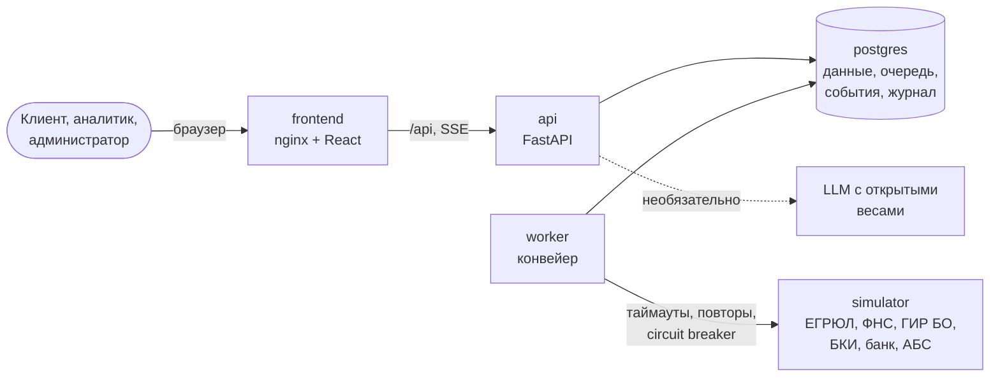

# Умный кредитный кабинет предпринимателя

Прототип цифрового кредитного конвейера для малого и микробизнеса — решение кейса Альфа-Банка на хакатоне «Альфа Будущее». Кабинет клиента и рабочее место кредитного аналитика связаны одной заявкой и одним процессом: от потребности бизнеса в деньгах до выдачи кредита.

**Версия для проверки — тег `v1.0.0`.** Репозиторий: <https://github.com/stonebridgeway/alfa-hakaton>. Демо-версия интерфейса без сервера, чтобы посмотреть кабинет без установки: <https://stonebridgeway.github.io/alfa-hakaton/>.

## Назначение

Предприниматель без банковской экспертизы описывает задачу своими словами и сразу видит подходящие продукты с платежом и переплатой. Заявка заполняется почти сама: данные компании подтягиваются из ЕГРЮЛ, финансы — из отчётности, БКИ и оборотов по счёту. Дальше заявка автоматически проходит проверку данных, внешние источники, скоринг и кредитную политику. Статус меняется на экране в реальном времени. Итог — не только «да» или «нет»: банк может предложить другие условия или запросить информацию. Подписание и выдача проходят прямо в кабинете.

Банк получает конвейер, который решает типовые заявки автоматически по прозрачным правилам, и рабочее место аналитика для остальных: очередь со сроками, досье со всеми источниками и объяснением скоринга, решения в пределах полномочий, журнал действий, контроль сбоев внешних систем.

| Для клиента | Для банка |
|---|---|
| Предварительное предложение на главной и подбор продукта по задаче, в том числе по описанию своими словами | Автоматический конвейер: проверка данных, ЕГРЮЛ/ЕГРИП, ФНС, ГИР БО, БКИ, обороты по счёту |
| Предварительный расчёт платежа и переплаты до заявки | Балльная скоринговая карта и кредитная политика с объяснением |
| Заявка с автозаполнением по ИНН | Четыре исхода: одобрение, контрпредложение, запрос информации, отказ |
| Статус и шаги проверки в реальном времени, уведомления в кабинете | Очередь, досье, решения аналитика с пересчётом условий |
| Понятные причины решения и альтернативы; прогноз кассового разрыва по выписке с подсказкой лимита | Устойчивость к сбоям источников: повторы, ожидание, перезапуск |
| Чат с банком, подписание, выдача и график платежей | Показатели конвейера для руководителя, журнал действий, сброс демо-данных, управление сбоями |

Почему решение устроено так и что вошло в MVP — в [docs/product.md](docs/product.md).

## Быстрый старт

```bash
git clone https://github.com/stonebridgeway/alfa-hakaton.git
cd alfa-hakaton
git checkout v1.0.0
docker compose up -d --build --wait
```

Откройте <http://localhost:8080>, нажмите «Войти» справа в шапке и выберите тестовую учётную запись, например `veter` (пароль у всех — `admin`). Первая сборка занимает несколько минут.

## Требования к окружению

| Что | Версия | Зачем |
|---|---|---|
| Docker с Compose v2 | Docker 24+ (Docker Desktop на Windows и macOS) | Запуск всех компонентов |
| Память | от 4 ГБ свободной | Сборка образов; работающий стенд занимает около 400 МБ ([замеры](docs/architecture.md#производительность-и-ресурсы)) |
| Порт | 8080 свободен (меняется через `APP_PORT`) | Веб-интерфейс |
| Браузер | Chrome, Edge, Firefox, Safari последних версий | Рабочее место аналитика — от 1280 px; кабинет клиента работает и на телефоне |
| Интернет | Только для первой сборки образов | Пакеты и базовые образы |

Для разработки и запуска тестов без Docker: Python 3.12 и [uv](https://docs.astral.sh/uv/) 0.11, Node.js 22.12 или новее.

## Запуск

```bash
docker compose up -d --build --wait   # или make up
```

Команда собирает образы, применяет миграции, загружает справочники, тестовые компании и две демо-заявки на ручное рассмотрение и ждёт, пока все сервисы будут готовы.

| Адрес | Что там |
|---|---|
| <http://localhost:8080> | Веб-интерфейс: кабинет клиента и рабочее место банка |
| <http://localhost:8080/api/docs> | Swagger UI — интерактивное описание API |
| <http://localhost:8080/api/health> | Проверка, что стенд работает |

Полезные команды ([Makefile](Makefile), `make help`):

| Команда | Что делает |
|---|---|
| `make reset` | Сбросить демо-данные: удалить заявки, снять сбои внешних систем. Без make: `docker compose exec api python -m app.seed --reset` |
| `make logs` | Логи всех сервисов |
| `make down` / `make clean` | Остановить стенд с сохранением данных / с удалением данных |
| `make test`, `make test-api`, `make e2e` | Юнит-тесты, сценарии через API, сценарии в браузере |

Публикация на внешнем сервере с HTTPS — в [docs/deploy.md](docs/deploy.md).

### Мониторинг (по желанию)

`api` и `worker` отдают метрики Prometheus, но только внутри сети Docker. Чтобы смотреть их, запустите стенд с профилем `monitoring`:

```bash
docker compose --profile monitoring up -d --build --wait
```

Prometheus открывается на <http://localhost:9090> (порт меняется через `PROMETHEUS_PORT`). Полезные запросы:

| Что | PromQL |
|---|---|
| Запросов в секунду по маршрутам | `sum by (route) (rate(http_requests_total[1m]))` |
| Время ответа API, 95-й перцентиль | `histogram_quantile(0.95, sum by (le) (rate(http_request_duration_seconds_bucket[5m])))` |
| Заявок в минуту доходит до кредитной политики | `sum(rate(pipeline_steps_total{step="POLICY"}[5m])) * 60` |
| Ошибки и тайм-ауты внешних систем | `sum by (source, result) (rate(external_calls_total{result!="ok"}[5m]))` |
| Источники с приостановленными вызовами | `circuit_breaker_open == 1` |
| Очередь заданий и заявки по статусам | `queue_jobs`, `applications` |

## Демо-версия без сервера

Для работы над интерфейсом есть сборка без бэкенда: запросы к API обслуживает имитация сервера прямо в браузере, данные хранятся в `localStorage`. Те же экраны, тестовые учётные записи и исходы заявок, что и на стенде, но без Docker. Проверяемая версия решения — по-прежнему стенд в Docker: настоящая логика конвейера, скоринга и политики живёт в бэкенде.

| Где | Как |
|---|---|
| На своём компьютере | `cd frontend && npm ci && npm run dev:demo` → <http://localhost:5173> |
| GitHub Pages | Workflow [pages.yml](.github/workflows/pages.yml) публикует демо-версию при каждом изменении фронтенда в `main`. Один раз включите Settings → Pages → Source: GitHub Actions; адрес — `https://<владелец>.github.io/<репозиторий>/`, для этого репозитория — <https://stonebridgeway.github.io/alfa-hakaton/> |

Чем имитация отличается от настоящего сервера, как её расширять при новых методах API и как обновлять снимки ответов — в [docs/demo-mode.md](docs/demo-mode.md).

## Архитектура



| Компонент | Что делает |
|---|---|
| `frontend` | Кабинет клиента и рабочее место банка на React и дизайн-системе Альфа-Банка; nginx раздаёт статику и проксирует API и поток событий |
| `api` | REST API на FastAPI: роли и вход, заявки, документы, предложения, подписание, рабочее место банка, поток событий (SSE), договоры в PDF |
| `worker` | Обработчик конвейера: проверка данных, внешние источники, скоринг, кредитная политика, формирование документов, выдача, таймеры сроков |
| `postgres` | Данные, очередь заданий (`SELECT … FOR UPDATE SKIP LOCKED`), события для интерфейса, журнал действий |
| `simulator` | Синтетические внешние системы для 10 тестовых компаний и управляемые сбои |

Смена статуса, событие и задание обработчику сохраняются в одной транзакции, поэтому заявка не теряется и не обрабатывается дважды. Подробнее — схема, последовательность обработки, безопасность, надёжность и масштабирование — в [docs/architecture.md](docs/architecture.md).

## Конфигурация и переменные окружения

Без настройки стенд работает на значениях по умолчанию. Чтобы изменить их, скопируйте [.env.example](.env.example) в `.env` (файл не попадает в репозиторий).

| Переменная | По умолчанию | Назначение |
|---|---|---|
| `APP_PORT` | `8080` | Порт веб-интерфейса на компьютере. На сервере — `127.0.0.1:8080` |
| `POSTGRES_PASSWORD` | `credit` | Пароль базы данных |
| `JWT_SECRET` | `change-me-in-production` | Секрет подписи токенов входа. На внешнем сервере обязательно заменить |
| `AI_ENABLED` | `false` | Включить ИИ-помощника |
| `LLM_BASE_URL` | `http://host.docker.internal:11434/v1` | Адрес модели с API в формате OpenAI: локальная Ollama или другой сервис с открытыми весами |
| `LLM_API_KEY` | пусто | Ключ доступа к модели, если сервис его требует (Ollama — не требует) |
| `LLM_MODEL` | `qwen3:4b` | Имя модели |
| `LLM_TIMEOUT_SECONDS` | `40` | Сколько ждать ответа модели, потом — разбор на правилах |
| `WORKER_CONCURRENCY` | `4` | Сколько заявок обработчик конвейера ведёт одновременно |
| `DOMAIN` | — | Домен для HTTPS при публикации на сервере ([docs/deploy.md](docs/deploy.md)) |

Внутренние адреса сервисов (`DATABASE_URL`, `SIMULATOR_URL`, `FILES_DIR`) задаются в [docker-compose.yml](docker-compose.yml). Таймеры процесса, повторы и пороги circuit breaker описаны в [backend/app/config.py](backend/app/config.py). Их можно переопределить переменными окружения с тем же именем в верхнем регистре, например `OFFER_TTL_HOURS`; для Docker такую переменную нужно добавить в блок `x-backend-env` файла `docker-compose.yml`.

## Используемые компоненты

| Слой | Компоненты |
|---|---|
| Бэкенд | Python 3.12, FastAPI, SQLAlchemy 2, Alembic, Pydantic 2, psycopg 3, PyJWT, bcrypt, httpx, ReportLab |
| Фронтенд | React 19, TypeScript, Vite 8, дизайн-система Альфа-Банка `@alfalab/core-components` (MIT), TanStack Query, React Router, шрифт Onest (OFL) |
| Инфраструктура | Docker Compose, PostgreSQL 16, nginx 1.27; для сервера — Caddy |
| Качество | pytest, ruff, Prettier, Playwright, GitHub Actions |
| ИИ (необязательно) | Модели с открытыми весами через API в формате OpenAI: Qwen3 4B в Ollama или другой бесплатный сервис |

Версии зафиксированы lock-файлами: [backend/uv.lock](backend/uv.lock), [simulator/uv.lock](simulator/uv.lock), [frontend/package-lock.json](frontend/package-lock.json), [e2e/package-lock.json](e2e/package-lock.json); базовые образы — точными тегами. Полный перечень сторонних компонентов, лицензий, моделей и смоделированных интеграций — в [THIRD_PARTY_NOTICES](THIRD_PARTY_NOTICES). Платные сервисы и закрытые лицензии не используются.

## Сценарий проверки

Тестовые учётные записи (пароль у всех — `admin`):

| Логин | Кто | Что показывает |
|---|---|---|
| `veter` | ООО «Северный ветер» | Автоодобрение, подписание и выдача |
| `smirnova` | ИП Смирнова | Контрпредложение по овердрафту |
| `tehnomaster` | ООО «ТехноМастер» | Два варианта условий на выбор |
| `orlov` | ИП Орлов | Банк запрашивает выписку, затем одобряет |
| `vektor` | ООО «Вектор Логистик» | Ручное рассмотрение с флагами |
| `grand` | ООО «Гранд Девелопмент» | Кредит под залог, решает аналитик |
| `start` | ООО «Новый старт» | Молодой бизнес |
| `altair` | ООО «Альтаир» | Сбой внешнего источника |
| `romashka`, `meridian` | ООО «Ромашка-Строй», ООО «Меридиан» | Отказ по стоп-фактору |
| `analyst`, `analyst2` | Кредитные аналитики | Рабочее место банка |
| `admin` | Администратор демо | Сброс данных и сбои внешних систем |

**Основной сценарий (5 минут):**

1. Войдите как `veter` → «Подобрать кредит».
2. В поле «Опишите задачу своими словами» напишите: «Нужно 3 млн на закупку товара к сезону, верну за 2 года» → «Подобрать по описанию». Цель, сумма и срок заполнятся, справа — подходящие продукты с платежом.
3. «Кредит на развитие бизнеса» → «Оформить заявку» → укажите выручку за последний год (обязательно, например 120 000 000) → «Далее» → отметьте согласия → «Отправить заявку».
4. Смотрите, как заявка проходит шаги проверки без перезагрузки страницы. Через несколько секунд — «Кредит одобрен» и объяснение, что повлияло на условия.
5. «Принять предложение» → договор в PDF → «Подписать договор» (пароль `admin`) → «Кредит выдан» и график платежей.
6. Войдите как `analyst`: в очереди заявка ООО «Вектор Логистик» на ручном рассмотрении. Откройте досье — источники, скоринг по факторам, расчёт лимита, флаги — и примите решение: например, «Изменить условия» с обоснованием превышения лимита.
7. Войдите как `admin` → «Конвейер и сбои» и включите сбой бюро кредитных историй. Отправьте заявку от `altair`: она остановится на шаге «Кредитная история» с пометкой «Ждём ответа бюро кредитных историй». Верните источник в рабочее состояние — проверка продолжится с того же шага, заявка не потеряется.

Все сценарии по шагам с ожидаемыми результатами — в [docs/test-scenarios.md](docs/test-scenarios.md). Перед повторной проверкой сбросьте данные: `make reset` или кнопка «Сбросить демо-данные» под `admin`.

## Тестовые данные

Все компании, люди, документы, заявки и финансовые показатели синтетические и созданы командой:

- справочники, пользователи и демо-заявки — [backend/app/seed/demo.py](backend/app/seed/demo.py);
- ответы внешних систем для 10 компаний — [simulator/sim/data/companies.json](simulator/sim/data/companies.json). Даты заданы относительно текущего дня, поэтому сценарии не устаревают;
- тестовые выписки по счёту в форматах 1С и CSV — [frontend/public/demo-files](frontend/public/demo-files).

Исход каждой заявки определяется данными компании, а не подменой в коде. Описание таблиц — в [docs/data-model.md](docs/data-model.md).

## Тесты

| Набор | Что проверяет | Команда |
|---|---|---|
| Юнит-тесты | Расчёты, скоринг, политика, разбор потребности, качество на эталонном наборе | `make test` |
| Сценарии через API | 17 сквозных сценариев на поднятом стенде, включая проверки ошибок и доступа | `make test-api` |
| Сценарии в браузере | 10 сценариев Playwright на десктопе и 7 клиентских на экране телефона: путь клиента, выписка с прогнозом, решение аналитика, доступ по ролям, возврат на стартовую страницу, окно регистрации, подтверждение выхода | `make e2e` |
| Те же сценарии на демо-версии | 10 сценариев Playwright на сборке без сервера и сверка имитации со снимками ответов API | `cd e2e && npm run test:demo`, `cd frontend && npm run demo:check` |
| Нагрузка | Время ответа API при 20 одновременных пользователях и пропускная способность конвейера ([замеры и цели](docs/architecture.md#производительность-и-ресурсы)) | `make load`, затем `make reset` |

Все наборы запускаются в GitHub Actions: линтеры и юнит-тесты, затем сборка образов, `docker compose up` и сценарии через API и в браузере ([.github/workflows/ci.yml](.github/workflows/ci.yml)).

## ИИ-помощник

Необязательное дополнение, по умолчанию выключено — основной сценарий работает без модели. С моделью помощник разбирает описание задачи клиента и пишет для аналитика сводку «сильные стороны / риски». Кредитных решений модель не принимает. Используются только модели с открытыми весами: Qwen3 4B в локальной Ollama вне Docker или другой бесплатный сервис с API в формате OpenAI. Установка, подключение и оценка качества — в [docs/ai.md](docs/ai.md).

## Документация

| Документ | Содержание |
|---|---|
| [docs/product.md](docs/product.md) | Пользователи, задачи, гипотезы, границы MVP и приоритеты |
| [docs/research](docs/research) | Кабинетное исследование по открытым отзывам предпринимателей, сценарий интервью и анкета |
| [docs/architecture.md](docs/architecture.md) | **Архитектурная схема**, компоненты, безопасность, надёжность, масштабирование |
| [docs/process.md](docs/process.md) | Кредитный процесс, **диаграмма состояний заявки**, правила переходов, таймеры |
| [docs/credit-policy.md](docs/credit-policy.md) | Продукты, скоринговая карта, стоп-факторы, расчёт лимита, решение |
| [docs/api.md](docs/api.md) | **Описание API**: роли, соглашения, методы, примеры, поток событий |
| [docs/api/openapi.json](docs/api/openapi.json) | **Спецификация OpenAPI** (то же — <http://localhost:8080/api/docs>) |
| [docs/api/postman_collection.json](docs/api/postman_collection.json), [docs/api/requests.http](docs/api/requests.http) | **Коллекция запросов**: Postman и HTTP-клиент IDE |
| [docs/data-model.md](docs/data-model.md) | **Модель данных**: ER-диаграмма и описание таблиц |
| [docs/test-scenarios.md](docs/test-scenarios.md) | **Тестовые сценарии** и автотесты |
| [docs/ai.md](docs/ai.md) | ИИ-помощник: модели, подключение, оценка качества |
| [docs/design.md](docs/design.md) | Интерфейс: дизайн-система, шрифт, компоновка, экраны |
| [docs/deploy.md](docs/deploy.md) | Публикация на внешнем сервере с HTTPS |
| [docs/demo-mode.md](docs/demo-mode.md) | Демо-версия без сервера: запуск, GitHub Pages, устройство имитации |
| [docs/Документация-проекта.pdf](docs/Документация-проекта.pdf) | Вся документация одним PDF (пересборка — [tools/docs-pdf](tools/docs-pdf)) |
| [docs/requirements.md](docs/requirements.md) | Соответствие требованиям ТЗ |
| [THIRD_PARTY_NOTICES](THIRD_PARTY_NOTICES) | Сторонние компоненты, модели, данные, сервисы и смоделированные интеграции |

## Структура репозитория

```
backend/      API и обработчик конвейера (FastAPI, SQLAlchemy, Alembic)
  app/domain/      скоринг, кредитная политика, финансовые расчёты
  app/pipeline/    очередь заданий и шаги конвейера
  app/api/         маршруты для клиента, банка, администратора
  tests/           юнит-тесты и сценарии через API
simulator/    симулятор внешних систем с синтетическими данными
frontend/     веб-интерфейс (React, дизайн-система Альфа-Банка), nginx
  src/demo/        имитация сервера для демо-версии без бэкенда
e2e/          сценарии в браузере (Playwright)
deploy/       публикация на сервере с HTTPS (Caddy)
docs/         документация
tools/        сборка документации в PDF
```
