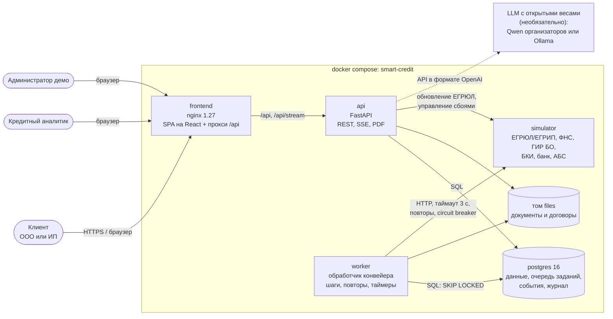
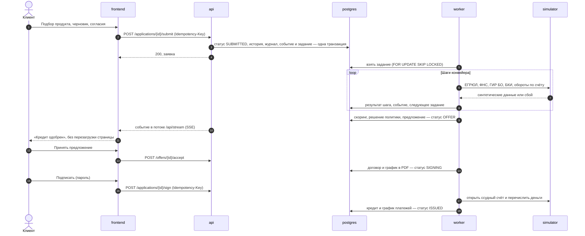

# Архитектура

Решение — модульный монолит на Python с отдельным обработчиком конвейера, веб-клиентом на React и симулятором внешних систем. Всё запускается одной командой `docker compose up` на обычном ПК, без доступа к системам банка и без платных сервисов.

## Схема

Наружу открыт только порт `frontend` (по умолчанию 8080). База, API, обработчик и симулятор доступны лишь внутри сети Docker.

## Компоненты

| Сервис | Технологии | Отвечает за | Масштабирование |
|---|---|---|---|
| `frontend` | React 19, TypeScript, Vite 8, дизайн-система Альфа-Банка `@alfalab/core-components`, TanStack Query; nginx | Кабинет клиента и рабочее место аналитика; раздаёт статику, проксирует `/api` и поток событий без буферизации | Статика, любое число копий за балансировщиком |
| `api` | Python 3.12, FastAPI, SQLAlchemy 2, Alembic, Pydantic 2, PyJWT, bcrypt, ReportLab | Вход и роли, заявки, документы, предложения, подписание, рабочее место банка, справочники, поток событий (SSE), ИИ-функции | Без состояния в памяти (JWT), горизонтально |
| `worker` | Тот же образ, `python -m app.pipeline.worker` | Шаги конвейера: проверка данных, внешние источники, скоринг, политика; формирование договора; выдача; таймеры сроков | Горизонтально: задания разбираются через `SELECT … FOR UPDATE SKIP LOCKED` |
| `postgres` | PostgreSQL 16 | Данные заявок и компаний, очередь заданий, события для уведомлений, журнал действий, ключи идемпотентности | Один экземпляр в демо; в боевом контуре — кластер |
| `simulator` | FastAPI | Синтетические ответы внешних систем для 10 тестовых компаний и управляемые сбои (ошибка, таймаут, медленный ответ) | Не требуется |

Код разделён на слои ([backend/app](../backend/app)):

| Слой | Каталог | Содержимое |
|---|---|---|
| Домен | `domain/` | Каталог продуктов, признаки, скоринговая карта, кредитная политика, финансовые расчёты. Чистые функции без базы и сети, покрыты юнит-тестами |
| Сервисы | `services/` | Машина состояний заявки, события, журнал, документы и разбор выписок, идемпотентность, ИИ-помощник |
| Конвейер | `pipeline/` | Очередь заданий, шаги, обработчик |
| Интеграции | `integrations/` | Клиент внешних систем с таймаутами, повторами и circuit breaker |
| API | `api/` | Маршруты по ролям: клиент, банк, администрирование, уведомления, ИИ |

## Основной сценарий в динамике

Статусы, переходы и таймеры описаны в [process.md](process.md), правила скоринга и решения — в [credit-policy.md](credit-policy.md), таблицы — в [data-model.md](data-model.md), API — в [api.md](api.md).

## Как устроен конвейер

- **Единая точка смены статуса.** Все переходы проходят через `services/workflow.py` и проверяются по таблице допустимых переходов с учётом роли. Смена статуса, запись в историю, журнал действий, событие для интерфейса и задание обработчику сохраняются в одной транзакции (transactional outbox): если транзакция откатилась, задание не появится, а если зафиксировалась — не потеряется.
- **Очередь заданий в PostgreSQL.** Обработчики забирают задания через `SELECT … FOR UPDATE SKIP LOCKED`, поэтому несколько копий `worker` не мешают друг другу. Задание, зависшее у упавшего обработчика дольше 120 секунд, возвращается в очередь.
- **Повторы.** Ошибка шага приводит к повтору с растущей паузой: от 2 до 30 секунд, не более 8 попыток. После последней попытки аналитики получают событие «Ошибка конвейера», а заявка видна на странице «Конвейер и сбои».
- **Circuit breaker.** После 5 ошибок подряд вызовы источника приостанавливаются на 20 секунд, чтобы не нагружать упавшую систему.
- **Ожидание источника.** Пока источник недоступен, заявка остаётся в автоматической проверке, клиент видит «Ждём ответа бюро кредитных историй». Если ожидание дольше лимита (15 минут в демо), заявка уходит аналитику с флагом F05. После восстановления источника аналитик перезапускает проверку.
- **Прогоны.** Каждый запуск конвейера по заявке — отдельный прогон (`run_no`). Результаты шагов хранятся по прогонам, поэтому повторная проверка после ответа клиента не затирает историю.
- **Таймеры.** Раз в 10 секунд обработчик закрывает просроченные предложения и запросы информации и возвращает зависшие задания.

## Обновление интерфейса без перезагрузки

Каждое изменение по заявке пишет событие в таблицу `events` с адресатом (клиент компании или сотрудники банка). Браузер держит соединение `GET /api/stream` (Server-Sent Events): API раз в секунду отдаёт новые события, при переподключении продолжает с `Last-Event-ID`. Получив событие, интерфейс перезапрашивает только затронутые данные. nginx проксирует поток без буферизации с таймаутом в час.

SSE выбраны вместо WebSocket: поток односторонний, работает через обычный HTTP-прокси и переподключается сам. Для боевой нагрузки опрос таблицы заменяется на `LISTEN/NOTIFY` или брокер сообщений без изменения контракта.

## Безопасность

| Мера | Реализация |
|---|---|
| Аутентификация | Логин и пароль, пароли хранятся как bcrypt-хеши. JWT (HS256) живёт 12 часов, секрет задаётся переменной `JWT_SECRET` |
| Авторизация | Роли `CLIENT`, `UNDERWRITER`, `ADMIN` проверяются на каждом маршруте. Клиент видит только заявки своей компании, чужие отдают 404. Переходы статусов дополнительно проверяются по роли |
| Конкурентные действия | Оптимистическая блокировка по версии заявки: если аналитик и клиент действуют одновременно, второй получает 409 «Заявка изменилась» |
| Повторные запросы | Отправка заявки и подписание идемпотентны по заголовку `Idempotency-Key` |
| Файлы | Белый список расширений, лимит 10 МБ (в nginx — 12 МБ). Файлы лежат вне веб-корня в каталоге заявки, к имени добавляется случайный префикс; выдача только через API с проверкой прав. Для каждого файла хранится SHA-256 |
| Подписание | Повторный ввод пароля, в журнал пишутся время, пользователь и SHA-256 договора |
| Журнал | Все действия пользователей и системы — в `audit_log` с идентификатором запроса |
| Веб | В стенде интерфейс и API отдаются с одного адреса через nginx; CORS разрешён только для локального дев-сервера Vite. Заголовки `X-Content-Type-Options`, `X-Frame-Options`, `Referrer-Policy` |
| Контейнеры | Сервисы на Python работают от непривилегированного пользователя, наружу открыт только порт веб-интерфейса |
| Данные | Только синтетические. Секреты (`JWT_SECRET`, ключ LLM) передаются через `.env`, который не попадает в репозиторий. В модель уходит только то, что нужно для задачи (см. [ai.md](ai.md)) |

## Надёжность и сопровождение

- **Запуск по готовности.** У `postgres`, `simulator` и `api` есть проверки здоровья. `api` стартует после базы и симулятора, применяет миграции и загружает справочники, остальные сервисы ждут готовности `api`. Все сервисы перезапускаются при сбое.
- **Пробы.** `GET /api/health` — процесс жив, `GET /api/ready` — доступна база.
- **Логи.** JSON-логи с идентификатором запроса, временем ответа и ключевыми полями задания: удобно собирать в ELK или Loki.
- **Миграции.** Схема базы ведётся в Alembic и применяется при старте.
- **Воспроизводимость.** Версии зафиксированы: `uv.lock` (Python), `package-lock.json` (npm), точные теги базовых образов, шрифты лежат в репозитории.
- **Проверки в CI.** Линтеры, юнит-тесты, сборка образов, сценарии через API и в браузере на поднятом стеке ([.github/workflows/ci.yml](../.github/workflows/ci.yml)).

## Масштабирование и путь к боевому контуру

| Сейчас (демо) | В боевом контуре |
|---|---|
| Один `api`, один `worker` | Несколько копий за балансировщиком; обработчики масштабируются без изменений кода (`docker compose up --scale worker=3` работает уже сейчас) |
| PostgreSQL в контейнере | Управляемый кластер с репликами и резервным копированием |
| Очередь заданий в PostgreSQL | Можно оставить (тот же паттерн outbox) или вынести в Kafka/RabbitMQ при росте нагрузки |
| Документы в томе Docker | Объектное хранилище S3 |
| Симулятор внешних систем | Адаптеры к ЕГРЮЛ/ЕГРИП, ФНС, ГИР БО, БКИ и АБС через интеграционную шину; контракты клиента `integrations/` сохраняются |
| Логин и пароль | Корпоративный IdP (Keycloak, OIDC), для клиентов — вход Альфа-Бизнес или ЕСИА |
| Простая электронная подпись паролем | УКЭП или подпись в мобильном приложении банка |
| Секреты в `.env` | Хранилище секретов (Vault) |
| JSON-логи | Сбор логов и метрик, трассировка, алерты на ошибки конвейера и превышение SLA |

## Почему так

| Решение | Альтернатива | Почему выбрали |
|---|---|---|
| Модульный монолит + отдельный обработчик | Микросервисы | Один репозиторий, одна схема данных и одна транзакция на смену статуса — меньше точек отказа при той же изоляции модулей. Обработчик масштабируется отдельно |
| Очередь в PostgreSQL | Kafka, RabbitMQ | Атомарность «статус + задание» без распределённых транзакций, на один сервис меньше в Docker. Паттерн переносится на брокер |
| Балльная скоринговая карта и явные правила | ML-модель | Прозрачно для аналитика и клиента, объясняется по факторам, не требует обучающих данных. Организаторы допускают упрощённую логику |
| Симулятор как отдельный сервис | Заглушки внутри кода | Сетевые вызовы, таймауты и сбои настоящие, поэтому повторы и circuit breaker проверяются в работе |
| SSE | WebSocket, опрос из браузера | Достаточно потока «сервер → клиент», работает через прокси, переподключается сам |
| Дизайн-система Альфа-Банка | Свои компоненты | Привычный клиентам банка интерфейс и доступность из коробки; фирменные шрифты заменены свободным Onest (см. [design.md](design.md)) |
| ИИ только как помощник | ИИ в решении | Решение должно быть объяснимым и воспроизводимым; модель заполняет форму и пишет сводку для аналитика, основной сценарий от неё не зависит |
