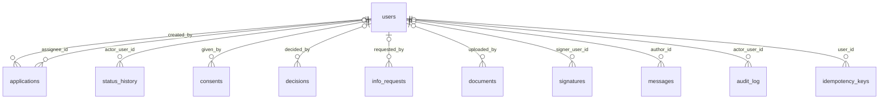

# Модель данных

Таблицы PostgreSQL, связи между ними и соглашения о хранении. Источник истины — модели SQLAlchemy
[`backend/app/models.py`](../backend/app/models.py) и миграция Alembic
[`0001_initial_schema.py`](../backend/migrations/versions/0001_initial_schema.py); допустимые значения статусов и
кодов — [`backend/app/domain/enums.py`](../backend/app/domain/enums.py). Процесс и статусы заявки описаны в
[process.md](process.md), устройство конвейера — в [architecture.md](architecture.md).

## ER-диаграмма

Все 20 таблиц и связи между ними, кроме ссылок на пользователя, который выполнил действие, — они на второй
схеме. Типы — типы PostgreSQL без размерностей: деньги — `NUMERIC(15,2)`, ставки — `NUMERIC(5,2)`, длины строк — в
миграции. PK — первичный ключ, FK — внешний ключ, UK — уникальное поле.

```mermaid
erDiagram
    companies |o--o{ users : "пользователи клиента"
    companies ||--o{ applications : "заявки"
    products ||--o{ applications : "продукт"
    applications ||--o{ status_history : "история статусов"
    applications ||--o{ consents : "согласия"
    applications ||--o{ pipeline_steps : "шаги прогонов"
    applications |o--o{ jobs : "задания"
    applications ||--o{ scoring_results : "скоринг"
    applications ||--o{ decisions : "решения"
    decisions ||--o{ offers : "варианты условий"
    applications ||--o{ offers : "предложения"
    products ||--o{ offers : "продукт"
    applications ||--o{ info_requests : "запросы информации"
    info_requests |o--o{ documents : "файлы ответа"
    applications ||--o{ documents : "документы"
    documents ||--o{ signatures : "подписи"
    applications ||--o{ signatures : "подписи"
    applications ||--o| loans : "кредит"
    offers ||--o| loans : "принятое предложение"
    products ||--o{ loans : "продукт"
    loans ||--|{ schedule_items : "график платежей"
    applications ||--o{ messages : "чат"
    applications |o--o{ events : "события"
    companies |o--o{ events : "лента клиента"

    companies {
        uuid id PK
        varchar inn UK "ИНН"
        varchar name
        varchar legal_form "OOO или IP"
        varchar ogrn
        date registration_date
        varchar okved
        varchar status "статус в ЕГРЮЛ"
        varchar director_name
        bool is_bank_client
        date bank_account_opened_at
        timestamptz registry_synced_at
    }
    users {
        uuid id PK
        varchar login UK
        varchar password_hash "bcrypt"
        varchar full_name
        varchar role "CLIENT UNDERWRITER ADMIN"
        uuid company_id FK "только у клиента"
        bool can_sign "право подписи"
        bigint last_read_event_id
    }
    products {
        varchar code PK "GROWTH, EXPRESS и др."
        varchar name
        varchar kind "LOAN OVERDRAFT CREDIT_LINE"
        numeric min_amount
        numeric max_amount
        int min_term
        int max_term
        numeric base_rate
        bool collateral_required
        numeric auto_limit
        bool always_manual
        jsonb purposes
    }
    applications {
        uuid id PK
        varchar number UK "2026-00001"
        uuid company_id FK
        uuid created_by FK "users"
        varchar product_code FK
        varchar purpose
        numeric amount
        int term_months
        numeric declared_revenue
        numeric collateral_value
        varchar status "AppStatus"
        timestamptz status_changed_at
        int run_no "последний прогон"
        uuid assignee_id FK "users"
        timestamptz sla_due_at
        timestamptz submitted_at
        timestamptz closed_at
        jsonb ai_parsed
        int version "оптимистическая блокировка"
    }
    status_history {
        bigint id PK
        uuid application_id FK
        varchar from_status
        varchar to_status
        varchar actor "CLIENT SYSTEM UNDERWRITER ADMIN"
        uuid actor_user_id FK "users"
        text reason
        timestamptz created_at
    }
    consents {
        uuid id PK
        uuid application_id FK "UK вместе с kind"
        varchar kind "BKI или PD"
        uuid given_by FK "users"
        varchar text_version
    }
    pipeline_steps {
        bigint id PK
        uuid application_id FK "UK вместе с run_no и step"
        int run_no
        varchar step
        varchar status
        int attempts
        timestamptz waiting_since
        timestamptz next_retry_at
        jsonb result
        text error
    }
    jobs {
        bigint id PK
        varchar kind
        uuid application_id FK
        jsonb payload
        varchar status
        timestamptz run_at
        int attempts
        timestamptz locked_at
        varchar locked_by
        text last_error
    }
    scoring_results {
        bigint id PK
        uuid application_id FK
        int run_no
        varchar scoring_version
        int score
        varchar risk_class "A, B, C, D, E"
        numeric pd
        jsonb features
        jsonb factors
    }
    decisions {
        bigint id PK
        uuid application_id FK
        int run_no
        varchar kind "AUTO или MANUAL"
        varchar outcome
        varchar policy_version
        numeric limit_amount
        varchar limit_binding
        numeric rate
        jsonb stop_factors
        jsonb flags
        jsonb reason_codes
        jsonb trace
        uuid decided_by FK "users"
    }
    offers {
        uuid id PK
        uuid application_id FK
        bigint decision_id FK
        int option_no
        varchar kind "AS_REQUESTED или COUNTER"
        varchar product_code FK
        numeric amount
        int term_months
        numeric rate
        numeric monthly_payment
        numeric overpayment
        timestamptz valid_until
        varchar status
    }
    info_requests {
        uuid id PK
        uuid application_id FK
        varchar origin "SYSTEM или UNDERWRITER"
        uuid requested_by FK "users"
        jsonb items
        timestamptz due_at
        varchar status
        text answer_text
    }
    documents {
        uuid id PK
        uuid application_id FK
        varchar kind
        varchar source "CLIENT BANK GENERATED"
        varchar file_name
        int size
        varchar sha256
        varchar storage_key "путь в FILES_DIR"
        uuid uploaded_by FK "users"
        uuid info_request_id FK
        jsonb parsed "разбор выписки"
    }
    signatures {
        uuid id PK
        uuid application_id FK
        uuid document_id FK "UK вместе с signer_role"
        varchar signer_role "CLIENT или BANK"
        uuid signer_user_id FK "users"
        varchar method
        varchar document_sha256
    }
    loans {
        uuid id PK
        uuid application_id FK, UK
        uuid offer_id FK
        varchar product_code FK
        varchar account_number
        numeric amount
        numeric rate
        int term_months
        numeric monthly_payment
        timestamptz issued_at
    }
    schedule_items {
        bigint id PK
        uuid loan_id FK
        int n "номер платежа"
        date due_date
        numeric payment
        numeric principal
        numeric interest
        numeric balance
    }
    messages {
        bigint id PK
        uuid application_id FK
        uuid author_id FK "users"
        varchar author_role
        text text
    }
    events {
        bigint id PK
        uuid application_id FK
        uuid company_id FK
        varchar audience "CLIENT BANK ALL"
        varchar kind
        varchar title
        bool notify
        jsonb payload
    }
    audit_log {
        bigint id PK
        varchar actor
        uuid actor_user_id FK "users"
        varchar action
        varchar entity_type
        varchar entity_id "строка, без FK"
        jsonb details
        varchar request_id
    }
    idempotency_keys {
        bigint id PK
        uuid user_id FK "users, UK вместе с scope и key"
        varchar scope
        varchar key
        jsonb response
    }
```

Кто выполнил действие — ссылки на `users`:

Общее для всех таблиц:

- Ключи: `uuid` — у компаний, пользователей, заявок, согласий, предложений, запросов информации, документов,
  подписей и кредитов; автоинкремент `bigint` — у истории статусов, шагов, заданий, результатов скоринга,
  решений, графика, сообщений, событий, журнала и ключей идемпотентности; у продукта ключ — код.
- Внешние ключи без каскадного удаления (`NO ACTION`): строку, на которую есть ссылки, удалить нельзя.
- Почти у всех таблиц есть `created_at timestamptz` со значением по умолчанию `now()`; его нет у `products`,
  `pipeline_steps` и `schedule_items`.
- Статусы, виды и коды хранятся строками (`varchar`), без перечислений PostgreSQL и ограничений CHECK. Допустимые
  значения задают перечисления в `enums.py`, подписи для клиента и банка — `domain/labels.py`.
- JSON хранится в `jsonb`.
- Служебная таблица `alembic_version` хранит номер версии схемы для миграций.

## Таблицы

Кто пишет: «API» — сервис `api` по действиям пользователей, «worker» — обработчик конвейера, «seed» — загрузка
демо-данных ([`backend/app/seed`](../backend/app/seed)).

### Компании, пользователи, продукты

**`companies`** — компании клиентов: профиль из ЕГРЮЛ/ЕГРИП и сведения о счёте в банке.

- Поля: `inn` (10 цифр у ООО, 12 у ИП), `legal_form` (`OOO`, `IP`), `ogrn`, `registration_date`, `okved` и
  `okved_name`, `address`, `status` (`ACTIVE`, `LIQUIDATING`, `REORGANIZING`, `BANKRUPTCY`, `LIQUIDATED`),
  `director_name`; `is_bank_client` и `bank_account_opened_at` — из внутренних данных банка; `registry_synced_at` —
  когда профиль последний раз обновлялся из реестра.
- Ограничения: UNIQUE `inn`.
- Пишет: seed создаёт компанию по ИНН и названию и подтягивает профиль из симулятора; API обновляет профиль, если
  он старше суток или клиент нажал «Обновить»; worker обновляет профиль на шагах ЕГРЮЛ и «Внутренние данные банка».

**`users`** — клиенты и сотрудники банка.

- Поля: `login`, `password_hash` (bcrypt), `full_name`, `position`, `role` (`CLIENT`, `UNDERWRITER`, `ADMIN`),
  `company_id` — компания клиента (у сотрудников пусто), `can_sign` — право подписывать договор от имени компании,
  `last_read_event_id` — последнее прочитанное уведомление.
- Ограничения: UNIQUE `login`; FK `company_id` → `companies`.
- Пишет: seed создаёт и обнуляет `last_read_event_id` при сбросе демо-данных; API меняет только
  `last_read_event_id`, когда пользователь открывает ленту уведомлений.

**`products`** — каталог кредитных продуктов ([credit-policy.md](credit-policy.md#каталог-продуктов)).

- Поля: `code` (`GROWTH`, `EXPRESS`, `SECURED`, `OVERDRAFT`, `CREDIT_LINE`, `STARTUP`), `kind` (`LOAN`,
  `OVERDRAFT`, `CREDIT_LINE`), границы суммы и срока, `base_rate`, `collateral_required`, `min_business_months` и
  `max_business_months`, `requires_bank_account_months`, `auto_limit` — максимум для автоматического одобрения,
  `always_manual`, `purposes` — коды целей (JSON-массив), `sort_order`, `active`.
- Ограничения: PK `code`.
- Пишет: seed — из [`backend/app/domain/catalog.py`](../backend/app/domain/catalog.py) при каждом запуске; API и
  worker только читают.

### Заявка

**`applications`** — заявка: параметры, текущий статус и служебные поля процесса.

- Поля: `number` — номер для людей; `purpose` (`WORKING_CAPITAL`, `CASH_GAP`, `EQUIPMENT`, `EXPANSION`) и
  `purpose_text`; `amount`, `term_months`; `declared_revenue`; `collateral_type` и `collateral_value`;
  `contact_name`; `status`, `status_changed_at`, `submitted_at`, `closed_at`; `run_no` — номер последнего прогона
  конвейера; `assignee_id` и `sla_due_at` — аналитик и срок ручного рассмотрения; `ai_parsed` — что распознал
  разбор описания задачи клиента (правила или модель) и исходный текст; `version`.
- Ограничения и индексы: UNIQUE `number`; индекс по `status` для очереди; FK на `companies`, `products`, `users`
  (`created_by`, `assignee_id`).
- Пишет: API клиента создаёт, правит и удаляет черновик; API банка назначает аналитика (`assignee_id`); статус
  и связанные с ним поля меняет только машина состояний (см. ниже) — из API клиента и банка, worker и seed
  (демо-заявки).

**`status_history`** — каждый переход статуса: `from_status`, `to_status`, `actor` (`CLIENT`, `SYSTEM`,
`UNDERWRITER`, `ADMIN`), `actor_user_id`, `reason`, `created_at`.

- Индекс по `application_id`.
- Пишет: только машина состояний. Строки не меняются и удаляются только при сбросе демо-данных.

**`consents`** — согласия на запрос в БКИ (`BKI`) и обработку персональных данных (`PD`): кто дал, когда, версия
текста согласия (`text_version`).

- Ограничения: UNIQUE (`application_id`, `kind`).
- Пишет: API при отправке заявки, seed для демо-заявок. Идентификатор согласия `BKI` передаётся в запрос к БКИ.

### Конвейер и решение

**`pipeline_steps`** — шаги прогона конвейера: `DATA_CHECK`, `EGRUL`, `FNS`, `GIRBO`, `BKI`, `BANK`, `SCORING`,
`POLICY`.

- Поля: `run_no`, `step`, `status` (`PENDING`, `RUNNING`, `DONE`, `SKIPPED`, `WAITING`, `FAILED`), `attempts`,
  `started_at`, `finished_at`, `waiting_since` и `next_retry_at` — ожидание недоступного источника, `result` —
  нормализованный ответ источника или результат проверки, `error`.
- Ограничения и индексы: UNIQUE (`application_id`, `run_no`, `step`); индекс по `application_id`.
- Пишет: машина состояний создаёт строки нового прогона; worker выполняет шаги и записывает результат.

**`jobs`** — очередь заданий обработчику.

- Поля: `kind` (`PIPELINE_STEP`, `GENERATE_DOCS`, `DISBURSE`), `payload` (для шага — `run_no` и `step`), `status`
  (`QUEUED`, `RUNNING`, `DONE`, `FAILED`, `CANCELLED`), `run_at` — не раньше какого времени выполнять,
  `attempts`, `locked_at` и `locked_by` — кто и когда взял, `last_error`, `finished_at`.
- Индексы: `ix_jobs_ready` (`status`, `run_at`) — для выборки готовых заданий; по `application_id`.
- Пишет: машина состояний и worker ставят задания, worker их выполняет; API банка по кнопке «Повторить сейчас»
  переносит `run_at` ожидающих заданий на текущий момент.

**`scoring_results`** — результат скоринговой карты на прогоне: `scoring_version`, `score`, `risk_class` (A–E),
`pd` — условная вероятность дефолта, %, `features` — входные признаки, `factors` — вклад каждого фактора в баллах
с формулировкой для клиента.

- Индекс по `application_id`.
- Пишет: worker на шаге `SCORING`.

**`decisions`** — решения по заявке, автоматические и ручные.

- Поля: `run_no`; `kind` (`AUTO`, `MANUAL`); `outcome` (`APPROVE`, `COUNTER`, `REJECT`, `NEED_INFO`,
  `MANUAL_REVIEW`); `policy_version`; `limit_amount` и `limit_binding` — расчётный лимит и что его ограничило
  (`PRODUCT_MAX`, `REVENUE`, `COLLATERAL`, `DSCR`, `OVERDRAFT`); `product_code` (без FK); `rate`; `stop_factors`
  (S01–S05), `flags` (F01–F07), `reason_codes` (R01–R07); `trace` — результат каждого правила политики;
  `comment`; `decided_by`.
- Индекс по `application_id`.
- Пишет: worker на шаге `POLICY` (`AUTO`), API банка — решение аналитика (`MANUAL`). Строки не меняются:
  версия политики, результат каждого правила (`trace`) и признаки в `scoring_results` позволяют проверить
  решение задним числом.

### Предложение, документы, выдача

**`offers`** — варианты условий для клиента: `option_no` (1 или 2), `kind` (`AS_REQUESTED`, `COUNTER`),
`product_code`, `amount`, `term_months`, `rate`, `monthly_payment`, `overpayment`, `valid_until` (по умолчанию
7 дней), `status` (`ACTIVE`, `ACCEPTED`, `DECLINED`, `EXPIRED`, `VOID`), `note`, `accepted_at`.

- Ограничения и индексы: FK `decision_id` → `decisions`; индекс по `application_id`.
- Пишет: worker (автоматическое решение, до двух вариантов) и API банка (решение аналитика, один вариант)
  создают. API клиента: принятый вариант — `ACCEPTED`, остальные — `VOID`; отказ от предложения — `DECLINED`;
  отзыв заявки — `VOID`. Worker переводит просроченные в `EXPIRED`.

**`info_requests`** — запросы документов и пояснений у клиента.

- Поля: `origin` (`SYSTEM` — от конвейера, `UNDERWRITER` — от аналитика), `requested_by`, `items` — пункты
  запроса из справочника (`BANK_STATEMENT`, `FIN_STATEMENT`, `TAX_EXPLANATION`, `ADDRESS_CONFIRMATION`,
  `COLLATERAL_DOCS`, `CONTRACTS`, `OTHER`), `comment`, `due_at`, `status` (`OPEN`, `ANSWERED`, `EXPIRED`,
  `CANCELLED`), `answer_text`, `answered_at`.
- Индекс по `application_id`.
- Пишет: worker (нет данных о выручке) и API банка создают; API клиента отвечает или отменяет при отзыве заявки;
  worker закрывает просроченные.

**`documents`** — метаданные файлов заявки; сами файлы — в каталоге `FILES_DIR` (см. «Документы и файлы»).

- Поля: `kind` (`BANK_STATEMENT`, `FIN_STATEMENT`, `COLLATERAL`, `OTHER`, `AGREEMENT`, `SCHEDULE`), `source`
  (`CLIENT`, `BANK`, `GENERATED`), `file_name`, `content_type`, `size`, `sha256`, `storage_key`, `uploaded_by`,
  `info_request_id` — к какому запросу приложен, `parsed` — разбор выписки.
- Индекс по `application_id`; FK `info_request_id` → `info_requests`.
- Пишет: API (загрузка клиентом и аналитиком, удаление клиентом своих файлов в черновике и при ответе на запрос),
  worker (договор в PDF).

**`signatures`** — подписи документа: `signer_role` (`CLIENT`, `BANK`), `signer_user_id`, `method`
(`PEP_PASSWORD` — простая электронная подпись паролем, `BANK_AUTO` — автоматическая подпись банка),
`document_sha256` — хэш подписанного документа.

- Ограничения и индексы: UNIQUE (`document_id`, `signer_role`); индекс по `application_id`.
- Пишет: API при подписании — сразу две строки, клиента и банка.

**`loans`** — выданный кредит: `account_number` — ссудный счёт из АБС, `amount`, `rate`, `term_months`,
`monthly_payment`, `issued_at`, ссылка на принятое предложение.

- Ограничения: UNIQUE `application_id` — у заявки не больше одного кредита.
- Пишет: worker на задании `DISBURSE`, после ответа АБС.

**`schedule_items`** — график платежей: `n`, `due_date`, `payment`, `principal`, `interest`, `balance` — остаток
долга после платежа.

- Индекс по `loan_id`.
- Пишет: worker вместе с кредитом, в той же транзакции. Последний платёж корректируется так, чтобы остаток стал
  `0.00`.

### Общение и уведомления

**`messages`** — чат по заявке: `author_id`, `author_role`, `text`.

- Индекс по `application_id`.
- Пишет: API клиента и банка; чат доступен после отправки заявки.

**`events`** — события для ленты уведомлений и потока SSE (см. ниже): `audience`, `kind`, `title`, `body`,
`notify`, `payload`.

- Индексы: по `application_id` и по `company_id`.
- Пишет: API и worker в той же транзакции, что и изменение данных
  ([`services/events.py`](../backend/app/services/events.py)).

### Служебные таблицы

**`audit_log`** — журнал действий (см. ниже).

- Индекс по `entity_id`.
- Пишет: API и worker ([`services/audit.py`](../backend/app/services/audit.py)).

**`idempotency_keys`** — ключи повторных запросов: `scope`, `key`, `response` (см. ниже).

- Ограничения: UNIQUE (`user_id`, `scope`, `key`).
- Пишет: API при отправке заявки и подписании.

## Статус заявки и история

- Текущий статус — `applications.status`, время последней смены — `status_changed_at`. Отдельно хранятся
  моменты отправки (`submitted_at`), закрытия (`closed_at` — при `ISSUED`, `REJECTED`, `DECLINED`, `CANCELLED`,
  `EXPIRED`) и срок ручного рассмотрения (`sla_due_at` — при переходе в `MANUAL_REVIEW`, через 24 часа).
- Статус меняет только функция `transition()` в
  [`backend/app/services/workflow.py`](../backend/app/services/workflow.py). Она проверяет переход по таблице
  допустимых переходов с учётом роли (недопустимый — ответ 409) и в одной транзакции записывает:
  - новый статус и служебные поля заявки;
  - строку `status_history`;
  - запись `STATUS_CHANGED` в `audit_log`;
  - события для интерфейса и уведомления в `events`;
  - задания обработчику: новый прогон конвейера, формирование договора или выдачу. При финальном статусе
    задания заявки в очереди снимаются.
- История только дополняется. Клиент видит переходы без внутренних формулировок банка (`reason`), сотрудники
  банка — полностью.

## Прогоны конвейера и очередь заданий

**Прогон** — один проход шагов конвейера по заявке. `applications.run_no` — номер последнего прогона. Он растёт
при отправке заявки, после ответа клиента на запрос конвейера и при перезапуске проверки аналитиком. В начале
прогона создаются восемь строк `pipeline_steps` в статусе `PENDING` и ставится задание на первый шаг; каждый
выполненный шаг ставит задание на следующий.

- UNIQUE (`application_id`, `run_no`, `step`) — одна строка на шаг в прогоне. Результаты прошлых прогонов
  сохраняются, интерфейсы и расчёты читают шаги текущего (`run_no = applications.run_no`).
- `scoring_results` и `decisions` тоже хранят `run_no`, поэтому видно, на каком прогоне получен результат.
- Задание устаревшего прогона (`run_no` в `payload` не совпадает с заявкой) завершается без действий.

**Очередь** — таблица `jobs`, без отдельного брокера
([`backend/app/pipeline/queue.py`](../backend/app/pipeline/queue.py)):

- Задание ставится в той же транзакции, что и изменение заявки (transactional outbox): откатилась транзакция —
  задания нет, зафиксировалась — задание не потеряется.
- Обработчик берёт одно готовое задание запросом
  `SELECT … FROM jobs WHERE status = 'QUEUED' AND run_at <= :now ORDER BY run_at, id LIMIT 1 FOR UPDATE SKIP LOCKED`,
  переводит его в `RUNNING`, записывает `locked_at`, `locked_by` (хост и PID) и увеличивает `attempts`.
  `SKIP LOCKED` позволяет запускать несколько копий `worker`: занятые строки они пропускают.
- Успех — `DONE`. Ошибка — `QUEUED` с новым `run_at`: пауза 2 с × 2^(n−1), не больше 30 с. После 8 попыток —
  `FAILED` и событие `JOB_FAILED` для аналитиков.
- Если внешний источник недоступен, шаг переходит в `WAITING` (`waiting_since`, `next_retry_at`, `error`), а
  задание переносится на `next_retry_at`. После 15 минут ожидания шаг становится `FAILED`, конвейер идёт дальше,
  заявка попадёт к аналитику с флагом F05.
- Раз в 10 секунд обработчик возвращает в очередь задания, которые висят в `RUNNING` дольше 120 секунд (упал
  процесс), и закрывает просроченные предложения и запросы информации.

## Оптимистическая блокировка

`applications.version` объявлен как `version_id_col` SQLAlchemy. Каждое изменение заявки выполняется запросом
`UPDATE … WHERE id = :id AND version = :прочитанная` и увеличивает версию. Если строку уже изменили, запрос не
обновит ни одной строки, SQLAlchemy выбросит `StaleDataError`, и API ответит 409 «Заявка изменилась, обновите
страницу».

Кроме того, все изменяющие обработчики API и worker читают заявку с блокировкой строки (`SELECT … FOR UPDATE`),
поэтому одновременные действия выполняются по очереди. Второе действие видит уже новый статус и получает 409 от
машины состояний: например, решение аналитика по заявке, которую клиент только что отозвал. Таймер истечения
предложений выбирает заявки с `FOR UPDATE SKIP LOCKED`, чтобы не ждать занятые.

## События: уведомления и SSE

Таблица `events` — общая лента для уведомлений и обновления интерфейса без перезагрузки.

- `audience` — кому: `CLIENT` — пользователям компании заявки (отбор по `company_id`), `BANK` — сотрудникам банка,
  `ALL` — обеим сторонам.
- `notify = true` — событие видно в ленте уведомлений и учитывается в счётчике непрочитанных. `false` — только
  сигнал интерфейсу перезапросить данные.
- `kind`: `STATUS_CHANGED` и `STATUS_<статус>` — смена статуса и уведомление о ней; `PIPELINE_STEP` и `UPDATED` —
  изменились шаги или документы; `MESSAGE` — сообщение в чате; `INFO_ANSWERED` — клиент ответил на запрос;
  `SOURCE_WAITING`, `SOURCE_FAILED`, `JOB_FAILED`, `DISBURSE_RETRY` — проблемы конвейера для банка.
- Непрочитанные — события с `notify = true` и `id` больше `users.last_read_event_id`. Когда пользователь
  открывает ленту, в `last_read_event_id` сохраняется наибольший `id` из доступных ему событий.
- Поток `GET /api/stream` раз в секунду выбирает события с `id` больше последнего отправленного и отдаёт их как
  Server-Sent Events, где `id` события — `events.id`. При переподключении поток продолжается с `Last-Event-ID`.
  `id` растёт монотонно: это автоинкремент `bigint`.

## Журнал действий

`audit_log` фиксирует, кто, что и над чем сделал:

- `actor` и `actor_user_id` — роль и пользователь (у действий конвейера — `SYSTEM` без пользователя);
- `action`: `LOGIN`, `DRAFT_CREATED`, `DRAFT_DELETED`, `STATUS_CHANGED`, `DOCUMENT_UPLOADED`, `AGREEMENT_SIGNED`,
  `ASSIGNED`, `PIPELINE_RETRY`, `FAULT_SET`, `DEMO_RESET`;
- `entity_type` и `entity_id` — объект (`application`, `user`, `simulator`, `system`) и его идентификатор строкой.
  Внешнего ключа нет: запись переживает удаление черновика и подходит для объектов разных типов;
- `details` — подробности: переход и причина, имя файла и SHA-256, идентификатор и SHA-256 подписанного договора;
- `request_id` — идентификатор HTTP-запроса (заголовок `X-Request-ID` или сгенерированный), по нему запись
  связывается с логами. У записей worker он пустой.

Записи пишутся в той же транзакции, что и действие, и не меняются. Журнал виден в досье заявки и на странице
«Журнал действий»; очищается только при сбросе демо-данных.

## Идемпотентность

Отправка заявки и подписание договора принимают заголовок `Idempotency-Key`
([`services/idempotency.py`](../backend/app/services/idempotency.py)).

- Ключ сохраняется в `idempotency_keys` с областью действия: `submit:<id заявки>` или `sign:<id заявки>`.
  UNIQUE (`user_id`, `scope`, `key`).
- Если ключ уже есть, API возвращает текущее состояние заявки и не выполняет действие повторно.
- Ключ записывается в той же транзакции, что и действие. Повтор, пришедший одновременно с первым запросом, ждёт
  блокировку строки заявки и затем находит ключ.
- Без заголовка повтор отклоняет машина состояний: заявка уже не в нужном статусе, ответ 409.
- Срока жизни у ключей нет, они удаляются при сбросе демо-данных.

## Документы и файлы

- Метаданные — в `documents`, содержимое — в каталоге `FILES_DIR` (`/data/files`). В Docker это том `files`,
  общий для `api` и `worker`. Файл лежит по пути `<id заявки>/<случайный hex>_<имя>`, путь хранится в
  `storage_key`. При сохранении считаются размер и SHA-256.
- Клиент загружает PDF, JPG, PNG, TXT и CSV до 10 МБ (`MAX_UPLOAD_MB`). Имя файла очищается от служебных символов
  и обрезается до 120 знаков.
- Выписка по счёту (`BANK_STATEMENT`) в формате 1С или CSV разбирается при загрузке. В `parsed` — период,
  число операций, поступления и списания по месяцам, среднемесячные поступления; эти данные использует скоринг.
- Договор с графиком платежей worker формирует в PDF (`AGREEMENT`, источник `GENERATED`) шрифтом DejaVu Sans.
  Вид `SCHEDULE` зарезервирован: график входит в договор и хранится в `schedule_items`.
- При подписании SHA-256 договора копируется в `signatures.document_sha256` и в запись журнала
  `AGREEMENT_SIGNED`.
- Файлы отдаются только через API (`GET /api/documents/{id}/download`) после проверки доступа к заявке.
- При удалении документа или черновика файлы удаляются с диска после фиксации транзакции; сброс демо-данных
  очищает каталог `FILES_DIR` целиком.

## Деньги и даты

- **Деньги** — `NUMERIC(15,2)`, до 9 999 999 999 999,99 ₽; в Python — `Decimal`. Расчёты
  ([`domain/finance.py`](../backend/app/domain/finance.py)) округляют до копеек по правилу ROUND_HALF_UP, лимит
  округляется вниз до 10 000 ₽.
- **Ставки** и вероятность дефолта — `NUMERIC(5,2)`, проценты: `19.00` — 19 % годовых.
- **В API** суммы и ставки в схемах ответов объявлены как `Decimal` и передаются строками (`"3000000.00"`), без
  потери точности. Расчётные показатели в досье аналитика отдаются числами.
- **В JSONB** — ответы источников, признаки скоринга, детали журнала — числа хранятся как в JSON. Суммы при
  расчётах переводятся в `Decimal`; коэффициенты (долговая нагрузка, рентабельность, доли) — числа с плавающей
  точкой.
- **Моменты времени** — `timestamptz`. Код записывает время в UTC (`datetime.now(UTC)`), значения по умолчанию
  ставит база (`now()`), часовой пояс базы — UTC. API отдаёт время в ISO 8601 с часовым поясом, интерфейс
  показывает его в часовом поясе браузера.
- **Календарные даты** без времени — `date`: регистрация компании, открытие счёта, даты платежей.
- **Сроки** кредита — целые месяцы (`term_months`). Таймеры процесса задаются в часах и минутах в настройках
  ([`backend/app/config.py`](../backend/app/config.py)).

## Номер заявки

Номер выдаёт последовательность PostgreSQL `application_number_seq` при создании черновика: `<год>-<номер>`,
номер — пять цифр с ведущими нулями, например `2026-00001`. Год берётся по UTC. Последовательность общая для всех
лет. Номер удалённого черновика или откатившейся транзакции повторно не выдаётся, поэтому в нумерации бывают
пропуски. Уникальность гарантирует UNIQUE `number`. При сбросе демо-данных нумерация начинается с 1.

## Персональные данные

Какие поля относятся к персональным данным:

- `users` — логин, ФИО, должность;
- `companies` — ФИО руководителя; у ИП ещё ИНН, ОГРНИП и адрес, потому что это данные человека;
- `applications` — ФИО заявителя (`contact_name`), описание цели и исходный текст в `ai_parsed`;
- `consents` — факт, время и версия текста согласий на обработку персональных данных и запрос в БКИ;
- `messages`, `info_requests.answer_text`, загруженные файлы (выписки содержат операции и контрагентов),
  `events.body` (текст сообщений чата и ответов на запросы), `audit_log.details` (имена файлов, причины решений).

Как защищены:

- В демо все данные синтетические, реальных людей и компаний нет (см. «Тестовые данные»).
- Пароли хранятся только как bcrypt-хеш. При подписании пароль сверяется с хешем и не сохраняется.
- Клиент видит только заявки, документы и события своей компании; чужая заявка отвечает 404. Методы рабочего
  места банка доступны только ролям `UNDERWRITER` и `ADMIN`.
- Файлы лежат вне веб-каталога и выдаются только через API после проверки доступа.
- В логи `api` и `worker` пишутся метод, путь, код ответа, длительность, `request_id` и идентификаторы заданий;
  тела запросов и ответы внешних систем в логи не попадают.
- В модель ИИ, если она включена, паспортные данные и контакты не передаются ([ai.md](ai.md)).
- Секреты (`JWT_SECRET`, ключ модели, пароль базы) задаются переменными окружения и не хранятся в репозитории.

## Тестовые данные

Все данные синтетические и созданы командой:

- [`backend/app/seed/demo.py`](../backend/app/seed/demo.py) — 10 компаний (ИНН и название), 13 пользователей,
  две демо-заявки; продукты — из [`domain/catalog.py`](../backend/app/domain/catalog.py);
- [`simulator/sim/data/companies.json`](../simulator/sim/data/companies.json) — ответы внешних систем для каждой
  компании: реестр, ФНС, отчётность, БКИ, поступления на счёт. Поле `persona` — какой сценарий показывает
  компания. Даты заданы в месяцах до текущего дня (`*_months_ago`), поэтому сценарии не устаревают;
- [`frontend/public/demo-files`](../frontend/public/demo-files) — выписка ИП Орлова в формате 1С (кодировка
  Windows-1251, как у выгрузки из 1С) и CSV.

ИНН тестовых компаний начинаются с `00` — такого кода налогового органа нет, поэтому совпадение с реальными
компаниями исключено. Контрольные цифры ИНН верные, проверка данных их пропускает.

**Загрузка.** При старте `api` выполняет миграции и `python -m app.seed`: продукты обновляются, компании и
пользователи создаются, если их нет, профили компаний подтягиваются из ЕГРЮЛ симулятора, демо-заявки — только
если заявок ещё нет. Повторный запуск ничего не дублирует.

**Сброс.** `make reset`, `python -m app.seed --reset` или кнопка «Сбросить демо-данные» под `admin`
(`POST /api/admin/demo/reset`): очищаются `applications` и все зависимые таблицы, `audit_log` и
`idempotency_keys`, нумерация заявок начинается с 1, удаляются файлы, снимаются сбои симулятора, снова создаются
две демо-заявки. Идентификаторы событий и заданий продолжают расти, чтобы открытые вкладки после сброса получали
новые события по `Last-Event-ID`. Компании, пользователи и продукты сохраняются.

### Тестовые компании

Пароль у всех — `demo`. У каждой компании один пользователь-клиент с правом подписи. Исход заявки определяют
данные компании в симуляторе; пошаговые сценарии — в [test-scenarios.md](test-scenarios.md).

| Логин | Компания | ИНН | Что показывает | Что в данных к этому ведёт |
|---|---|---|---|---|
| `veter` | ООО «Северный ветер» | 0010000017 | Автоодобрение, подписание и выдача | 6 лет работы, выручка 120 млн ₽ с ростом, без просрочек, клиент банка 5 лет со стабильными поступлениями |
| `smirnova` | ИП Смирнова Анна Викторовна | 001000000436 | Контрпредложение по овердрафту: 440 000 ₽ вместо 1 млн ₽ | Поступления на счёт около 1,1 млн ₽ в месяц; лимит овердрафта — 40 % поступлений |
| `tehnomaster` | ООО «ТехноМастер» | 0010000024 | Два варианта условий: та же сумма на больший срок или меньшая сумма | Платежи по двум действующим кредитам — 300 тыс. ₽ в месяц, не клиент банка |
| `orlov` | ИП Орлов Дмитрий Сергеевич | 001000001006 | Запрос выписки, затем автоматическое одобрение | ИП не сдаёт отчётность в ГИР БО и не обслуживается в банке — выручку нечем подтвердить; в выписке около 700 тыс. ₽ поступлений в месяц |
| `vektor` | ООО «Вектор Логистик» | 0010000031 | Ручное рассмотрение: флаги F01 и F02, запрос пояснений, решение аналитика | Адрес массовой регистрации, налоговая задолженность 82 тыс. ₽; демо-заявка — кредит на развитие 12 млн ₽ на 36 мес. |
| `romashka` | ООО «Ромашка-Строй» | 0010000056 | Отказ по стоп-фактору S01 | Статус в ЕГРЮЛ — в процессе ликвидации |
| `grand` | ООО «Гранд Девелопмент» | 0010000063 | Кредит под залог — всегда решает аналитик | Продукт `SECURED`; демо-заявка — 60 млн ₽ на 84 мес. под залог недвижимости стоимостью 120 млн ₽ |
| `start` | ООО «Новый старт» | 0010000070 | Молодой бизнес: доступен только кредит для начинающих, решение за аналитиком | 5 месяцев с регистрации, нет кредитной истории |
| `altair` | ООО «Альтаир» | 0010000088 | Сбой внешнего источника: заявка ждёт и продолжает обработку | Надёжный профиль: 8 лет работы, без долгов, стабильные поступления — исход зависит только от сбоя |
| `meridian` | ООО «Меридиан» | 0010000095 | Отказ по стоп-фактору S03 | Текущая просрочка 47 дней |

У `vektor` в кабинет входит финансовый директор с правом подписи по доверенности; руководитель по ЕГРЮЛ — другой
человек.

### Сотрудники банка

| Логин | Пользователь | Роль | Что может |
|---|---|---|---|
| `analyst` | Иванова Ольга Дмитриевна, кредитный аналитик | `UNDERWRITER` | Очередь, досье, решения, запросы информации, чат |
| `analyst2` | Ковалёв Павел Игоревич, кредитный аналитик | `UNDERWRITER` | То же: второй аналитик для параллельной работы |
| `admin` | Администратор демо-стенда | `ADMIN` | То же, что аналитик, плюс сброс демо-данных и сбои внешних систем |
