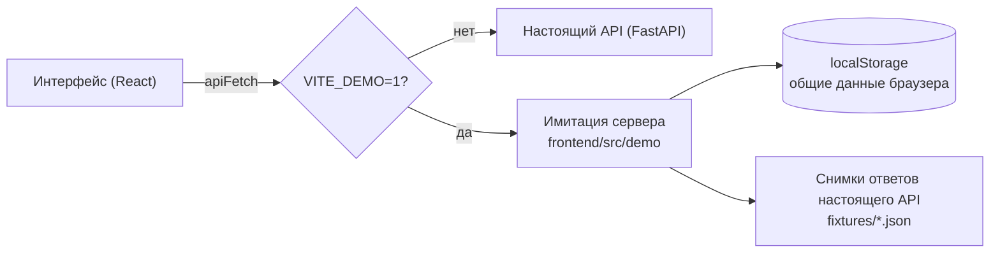

# Демо-версия без сервера (GitHub Pages)

Интерфейс можно показать без Docker и без бэкенда: в сборке с `VITE_DEMO=1` все запросы к API обслуживает имитация сервера прямо в браузере. Это тот же фронтенд — кабинет клиента и рабочее место банка с теми же экранами, тестовыми учётными записями и сценариями из [test-scenarios.md](test-scenarios.md), — но данные хранятся в браузере, а конвейер проверок работает во вкладке. Такую сборку публикует на GitHub Pages workflow [pages.yml](../.github/workflows/pages.yml).



## Что это и чем не является

- **Это витрина интерфейса и сценариев.** Подбор продукта, заявка, шаги проверки в реальном времени, предложение, подписание, выдача с графиком, запросы информации, чат, очередь и досье аналитика, решения в пределах полномочий, сбои внешних систем и сброс данных работают так же, как на стенде.
- **Расчёты и решения — те же, что на сервере.** В браузер перенесены каталог продуктов и формулы (`backend/app/domain`: аннуитет и график, признаки, скоринговая карта, кредитная политика, проверка полномочий аналитика), разбор описания задачи на правилах (`backend/app/services/ai.py`) и разбор выписки 1С/CSV. Ответы внешних источников по каждой тестовой компании сняты с настоящего симулятора. Поэтому у `veter` автоодобрение, у `smirnova` контрпредложение на 440 000 ₽, у `tehnomaster` два варианта, у `orlov` запрос выписки, `romashka` и `meridian` получают отказ с теми же текстами — проверка `npm run demo:check` сверяет это со снимками настоящего API.
- **Это не замена бэкенду.** Настоящая логика, хранение, безопасность и интеграции живут в `backend/` и `simulator/`. Имитация — упрощённая копия для показа: нет базы данных, настоящей авторизации, очереди заданий на сервере и проверок на гонки между пользователями.
- **Данные свои у каждого браузера.** Всё лежит в `localStorage` под одним ключом и общее для всех демо-пользователей этого браузера: аналитик одобрил заявку — выйдите и войдите клиентом в том же браузере, и предложение уже в кабинете. В другом браузере, на другом устройстве или в приватном окне — свои данные.

Над шапкой демо-версии всегда видна полоса «Демо-версия без сервера: данные хранятся в этом браузере».

## Запуск на своём компьютере

Нужен только Node.js 22:

```bash
cd frontend
npm ci
npm run dev:demo          # http://localhost:5173, режим разработки
```

Сборка, как на GitHub Pages, и её просмотр:

```bash
npm run build:demo        # dist/ с имитацией сервера
npm run preview           # http://localhost:4173
```

Обычные команды `npm run dev` и `npm run build` собирают интерфейс для настоящего API — кода имитации в такой сборке нет.

Сбросить демо-данные: войдите как `admin` (пароль `demo`), откройте «Конвейер и сбои» → «Сбросить демо-данные». Стартовые заявки `vektor` и `grand` снова пройдут конвейер и встанут в очередь аналитика. Можно и просто очистить данные сайта в браузере.

## Публикация на GitHub Pages

Workflow [pages.yml](../.github/workflows/pages.yml) запускается при изменениях в `frontend/` на ветке `main` или вручную (Actions → «GitHub Pages — демо-версия интерфейса» → Run workflow):

1. собирает `npm run build:demo` с `VITE_BASE=/<репозиторий>/` — сайт на Pages живёт в подкаталоге, адреса ресурсов и маршрутов строятся от него (`import.meta.env.BASE_URL`);
2. копирует `index.html` в `404.html`: Pages отдаёт его на неизвестные адреса, поэтому прямые ссылки на страницы приложения тоже открываются;
3. публикует `frontend/dist`.

Чтобы включить публикацию, один раз в настройках репозитория выберите **Settings → Pages → Build and deployment → Source: GitHub Actions**. Адрес демо-версии: `https://<владелец>.github.io/<репозиторий>/`; для основного репозитория — <https://stonebridgeway.github.io/alfa-hakaton/>.

## Как устроена имитация

Все обращения интерфейса к серверу идут через `apiFetch` в [client.ts](../frontend/src/api/client.ts): JSON-запросы, загрузка файлов, скачивание документов и поток событий [stream.ts](../frontend/src/api/stream.ts). В демо-сборке `apiFetch` подгружает отдельный чанк `frontend/src/demo/server.ts` и вызывает `demoFetch(path, init)`, который возвращает настоящие объекты `Response` — интерфейс не знает, что сервера нет.

| Файл | Что делает |
|---|---|
| `server.ts` | Разбор запроса, маршрутизация, ответы и ошибки в формате FastAPI (`{"detail": ...}`, 401/403/404/405/409/422) |
| `routes.ts` | Обработчики всех методов API — порт `backend/app/api/*.py` с теми же проверками, порядком проверок и текстами ошибок |
| `views.ts` | Сборка ответов: карточка заявки, досье, очередь, сводка, уведомления, журнал — порт `services/views.py` |
| `workflow.ts` | Машина состояний заявки, история, журнал действий, события и уведомления — порт `services/workflow.py` |
| `pipeline.ts`, `scheduler.ts`, `timing.ts` | Обработчик конвейера: шаги DATA_CHECK → EGRUL → FNS → GIRBO → BKI → BANK → SCORING → POLICY с задержками как у симулятора, формирование договора, выдача; сбои источников, повторы с растущей паузой, circuit breaker, ожидание до 15 минут и флаг F05; истечение предложений и запросов |
| `stream.ts` | `GET /api/stream`: поток Server-Sent Events через `ReadableStream`, `Last-Event-ID` при переподключении |
| `store.ts`, `seed.ts` | Данные в `localStorage` (ключ `credit-cabinet-demo-state-v1`), транзакции с откатом при ошибке, исходные данные и сброс |
| `data.ts` | Пользователи, профили компаний и ответы источников из снимков; даты сдвигаются к сегодняшнему дню |
| `engine/` | Порт домена: `catalog`, `finance`, `features`, `scoring`, `policy`, `text`, разбор потребности `ai` и выписки `statements` |
| `DemoNotice.tsx` | Полоса «демо-версия» над шапкой |
| `fixtures/` | Снимки ответов настоящего API (см. ниже) |
| `selfcheck.ts` | Сверка имитации со снимками, запускается `npm run demo:check` |

Особенности, которые стоит знать:

- **Конвейер работает во вкладке.** Задания хранятся вместе с данными, поэтому после перезагрузки страницы проверка продолжается с того же шага; если вкладка была закрыта, конвейер «дорабатывает» пропущенное время, как сервер. Если открыто несколько вкладок, задания выполняет одна — видимая (Web Locks API), остальные получают изменения через `localStorage`.
- **Внешние источники** отвечают данными, снятыми с симулятора для каждой из десяти тестовых компаний. Даты в ответах отсчитаны от дня съёмки и сдвигаются к сегодняшнему дню, поэтому срок бизнеса, обороты по месяцам и история кредитов не «стареют»: «Новому старту» всегда 5 месяцев.
- **Договор** — один настоящий PDF со стенда (`frontend/public/demo/agreement-sample.pdf`, заявка `veter` на 3 000 000 ₽ на 24 мес.), он открывается для любой заявки.
- **Загруженные файлы** хранятся только в памяти вкладки. Разобранная выписка и запись о документе сохраняются, а открыть сам файл после перезагрузки страницы нельзя — вместо него откроется пояснение.

## Снимки ответов API

Файлы в `frontend/src/demo/fixtures/` получены с запущенного стенда скриптом [capture-demo-fixtures.mjs](../frontend/scripts/capture-demo-fixtures.mjs): он сбрасывает демо-данные, проходит сценарии всех тестовых компаний через настоящий API и сохраняет ответы, а в конце снова сбрасывает данные.

| Файл | Используется | Что внутри |
|---|---|---|
| `meta.json`, `products.json` | имитацией | Справочники `/api/meta` и каталог `/api/products` |
| `users.json`, `companies.json` | имитацией | Пользователи (`/api/auth/login`), профили компаний (`/api/company`) и ответы ЕГРЮЛ, ФНС, ГИР БО, БКИ и банка по каждой компании из досье аналитика |
| `faults.json`, `agreement.json`, `ai-status.json` | имитацией | Внешние системы симулятора, размер и SHA-256 образца договора, режим ИИ |
| `scenarios.json` | проверкой | Заявки и досье в ключевых состояниях по каждому сценарию |
| `examples.json` | проверкой | Полные ответы методов — для сверки набора полей |
| `quotes.json`, `previews.json`, `statements.json`, `ai-golden.json` | проверкой | Подбор продуктов, расчёт условий аналитиком, разбор демо-выписок, разбор фраз эталонного набора `backend/app/ai_eval/golden_set.json` правилами сервера |
| `notifications.json`, `errors.json` | проверкой | Тексты уведомлений и ошибок |

В сборку попадают только файлы из первых трёх строк (около 50 КБ), остальные нужны проверке.

Обновить снимки после изменений в бэкенде:

```bash
docker compose up -d --build --wait     # стенд на http://localhost:8080
cd frontend
npm run demo:capture                    # или: node scripts/capture-demo-fixtures.mjs --api <адрес стенда>
npm run demo:check                      # имитация совпадает с новыми снимками?
```

Если проверка нашла расхождения — значит, изменилась логика сервера, и её нужно перенести в имитацию (`engine/`, `routes.ts`, `views.ts`). Данные, сохранённые в браузерах со старыми снимками, при первом открытии новой версии сбрасываются к исходным.

## Как расширить имитацию при новых методах API

1. Добавьте маршрут в таблицу `ROUTES` в `routes.ts` и обработчик рядом с остальными: проверка роли (`clientOnly`, `bankStaff`, `adminOnly`), проверка тела через `Validator` (ошибки 422 как у Pydantic), загрузка заявки через `load` или `loadForBank` (404 как на сервере), изменения — внутри `transact`, чтобы при ошибке данные откатились.
2. Смену статуса делайте только через `transition` из `workflow.ts` — она пишет историю, журнал, события и ставит задания конвейеру. Новые сущности добавьте в `DemoState` (`model.ts`), начальные значения — в `seed.ts`. Если меняется формат хранимых данных, увеличьте `STATE_VERSION` в `seed.ts`: старые данные в браузерах сбросятся к исходным.
3. Ответ соберите в `views.ts` с типами из `frontend/src/api/types.ts` — так TypeScript проверит, что имитация отдаёт то же, что ждёт интерфейс.
4. Если метод вызывается после изменения данных, разбудите обработчик (`kick()`), если нужно обновить интерфейс у других пользователей — создайте событие (`emit` или `refresh`).
5. Добавьте вызов метода в скрипт съёмки и сверку в `selfcheck.ts`, обновите снимки и запустите `npm run demo:check`.

## Проверки

- `npm run demo:check` (в `frontend`) — проходит сценарии всех компаний через `demoFetch` в Node с ускоренным временем и сверяет статусы, предложения, суммы, платежи и переплаты, график, скоринг, решения и лимиты, расчёт условий, подбор, тексты ошибок и уведомлений, разбор выписок и 32 фраз эталонного набора со снимками настоящего API. Около 5 секунд.
- `npm run test:demo` (в `e2e`) — те же сценарии Playwright, что и для стенда, на демо-сборке: Playwright сам собирает её и поднимает `vite preview` на порту 4173. Состояние перед тестом сбрасывается очисткой хранилища, а сценарии с двумя участниками выполняются в одном браузере с выходом и входом. Локально можно указать установленный Chromium: `PW_CHROMIUM_PATH=/путь/к/chrome npm run test:demo`.
- В CI это задание «Сквозные сценарии на демо-версии без сервера» ([ci.yml](../.github/workflows/ci.yml)), ему не нужен Docker.

## Ограничения

- Данные живут в одном браузере, их не видят другие люди и устройства. Ёмкость `localStorage` ограничена (около 5 МБ); старые события и записи журнала отбрасываются, лента уведомлений и журнал показывают последние.
- Нет настоящей авторизации: пароль у всех `demo`, токен не истекает, права проверяются так же, как на сервере, но только внутри браузера.
- ИИ работает только на правилах: модели нет, сводка досье для аналитика недоступна — как на стенде с выключенным ИИ.
- Список компаний фиксирован: заявку можно подать только от десяти тестовых компаний, их данные во внешних источниках не меняются.
- Конвейер выполняется, пока открыта хотя бы одна вкладка демо-версии. Действие во вкладке, закрытой в ту же долю секунды, может не сохраниться.
- Шаг, который выполняется прямо сейчас, показан как «выполняется» с текстом ожидания. На стенде результат шага появляется сразу после выполнения.
- Одновременных действий разных людей нет, поэтому ответа «Заявка изменилась, обновите страницу» (409) имитация не даёт.
- Ошибки проверки ввода (422) повторяют сообщения Pydantic для основных случаев; путь до поля (`loc`) может отличаться.
- Суммы считаются в числах с плавающей точкой с округлением как у `Decimal` на сервере; на всех снятых сценариях результаты совпадают до копейки, но в редких пограничных случаях возможна разница в копейку.
- Логика перенесена вручную. После изменений в `backend/app/domain`, `services` или `api` обновите снимки и запустите проверку — расхождения покажут, что поправить в имитации.
