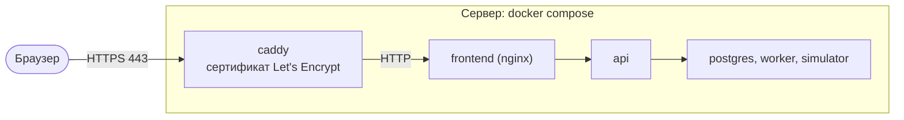

# Публикация на внешнем сервере

Организаторы рекомендуют заранее поднять решение на бесплатном внешнем сервере для демонстрации. Онлайн-версия дополняет локальный запуск, но не заменяет его: проверяемая версия решения — стенд, который жюри поднимает по [README](../README.md) командой `docker compose up`. На сервере разворачивается тот же `docker compose`, перед ним ставится [Caddy](https://caddyserver.com/), который сам выпускает сертификат Let's Encrypt.

Отдельно от сервера есть демо-версия интерфейса без бэкенда на GitHub Pages — <https://stonebridgeway.github.io/alfa-hakaton/> ([demo-mode.md](demo-mode.md)). Ей не нужен сервер вовсе, но она и не показывает серверную часть: конвейер, очередь заданий и имитацию внешних систем там заменяет код в браузере.



## Что нужно

- Виртуальная машина с Linux (например, Ubuntu 22.04 или 24.04), 2 vCPU, 4 ГБ памяти, 15 ГБ диска. Подойдёт бесплатная ВМ облачного провайдера, например Always Free в Oracle Cloud, или любой VPS. Базовые образы мультиархитектурные, а в lock-файле фронтенда есть сборки инструментов и для ARM.
- Открытые входящие порты 22, 80 и 443.
- Доменное имя, которое указывает на IP сервера. Если своего домена нет, подойдёт имя вида `203-0-113-10.sslip.io`, где цифры — IP сервера через дефис: сервис sslip.io сам отвечает этим адресом.

## Установка

1. Установите Docker с Compose v2 (официальный скрипт):
   ```bash
   curl -fsSL https://get.docker.com | sudo sh
   sudo usermod -aG docker $USER && newgrp docker
   ```
2. Склонируйте репозиторий на сдаваемой версии:
   ```bash
   git clone https://github.com/stonebridgeway/alfa-hakaton.git
   cd alfa-hakaton
   git checkout v1.0.0
   ```
3. Создайте `.env` из образца и задайте значения для сервера:
   ```bash
   cp .env.example .env
   ```
   ```env
   DOMAIN=203-0-113-10.sslip.io
   APP_PORT=127.0.0.1:8080
   JWT_SECRET=<результат openssl rand -hex 32>
   POSTGRES_PASSWORD=<результат openssl rand -hex 16>
   ```
   `APP_PORT=127.0.0.1:8080` закрывает прямой доступ к стенду снаружи — весь трафик идёт через HTTPS.
4. Запустите:
   ```bash
   docker compose -f docker-compose.yml -f deploy/docker-compose.prod.yml up -d --build --wait
   ```
   Первая сборка занимает 5–10 минут.
5. Проверьте: `https://<DOMAIN>/api/health` отвечает `{"status":"ok"}`, на `https://<DOMAIN>` открывается страница входа.

## Маленький сервер: 1 ядро, 2 ГБ памяти

Стенд помещается и на минимальный тариф (все сервисы вместе занимают около 500 МБ памяти), но сборка образов
на такой машине требует подготовки:

1. Включите файл подкачки на 2 ГБ — сборка фронтенда (`npm ci` и Vite) без него может упасть по памяти:
   ```bash
   sudo fallocate -l 2G /swapfile && sudo chmod 600 /swapfile && sudo mkswap /swapfile && sudo swapon /swapfile
   echo '/swapfile none swap sw 0 0' | sudo tee -a /etc/fstab
   ```
2. Собирайте образы по одному, а не параллельно, и только потом запускайте:
   ```bash
   docker compose -f docker-compose.yml -f deploy/docker-compose.prod.yml build simulator
   docker compose -f docker-compose.yml -f deploy/docker-compose.prod.yml build api
   docker compose -f docker-compose.yml -f deploy/docker-compose.prod.yml build frontend
   docker compose -f docker-compose.yml -f deploy/docker-compose.prod.yml up -d --wait
   ```
   На одном ядре это 10–15 минут. Образы `api` и `worker` одинаковые, второй соберётся из кеша.
3. В `.env` оставьте `WORKER_CONCURRENCY=2`: четыре потока обработчика на одном ядре только мешают друг другу.
4. ИИ-помощника на таком сервере не включайте (`AI_ENABLED=false`, значение по умолчанию): даже самая маленькая
   модель займёт 600 МБ и единственное ядро, а основной сценарий от модели не зависит. Жюри может включить
   помощника у себя по [ai.md](ai.md). Профиль `monitoring` (Prometheus и Grafana) тоже лучше не поднимать.
5. После запуска проверьте память: `free -m` и `docker stats --no-stream` — в сумме сервисы должны занимать
   меньше 1 ГБ, остальное остаётся системе и сборкам при обновлении.

## Перед показом

- Сбросьте демо-данные: `make reset` на сервере или кнопка «Сбросить демо-данные» на странице «Конвейер и сбои» под `admin`.
- Пройдите ключевой сценарий из [test-scenarios.md](test-scenarios.md) (С1).
- Если включаете ИИ, добавьте в `.env` параметры модели из [ai.md](ai.md) и повторите команду запуска. На сервере без видеокарты локальная модель будет медленной — лучше отдельный сервис с открытыми весами.

## Обновление и остановка

```bash
git pull
docker compose -f docker-compose.yml -f deploy/docker-compose.prod.yml up -d --build --wait
docker compose -f docker-compose.yml -f deploy/docker-compose.prod.yml down      # остановить, данные сохранятся
```

## Безопасность стенда

- Данные на стенде синтетические, тестовые учётные записи с паролем `demo` известны всем — это демо, а не боевой контур.
- Обязательно замените `JWT_SECRET` и `POSTGRES_PASSWORD`. Ключ LLM храните только в `.env` на сервере.
- Наружу открыты только 80 и 443 (Caddy). База, API, обработчик и симулятор доступны лишь внутри сети Docker.
- Включите межсетевой экран: `sudo ufw allow 22,80,443/tcp && sudo ufw enable`.
