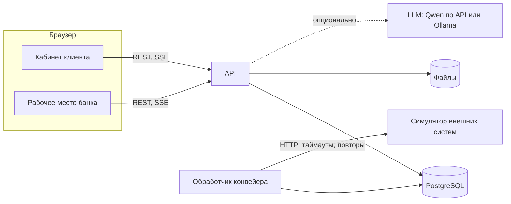

# План реализации

Рабочий документ команды: с ним начинали разработку. Итоговое устройство решения — в [README](../README.md) и [architecture.md](architecture.md), фактические тестовые компании и исходы — в [test-scenarios.md](test-scenarios.md).

## 1. Коротко

- **Что делаем.** Веб-прототип цифрового кредитного конвейера для малого и микробизнеса. Кабинет клиента и рабочее место кредитного аналитика связаны одной заявкой и одной машиной состояний.
- **Концепция («Умный конвейер»).** Клиент начинает с задачи, а не с анкеты. Данные компании подтягиваются по ИНН. Заявка автоматически проходит проверку данных, запросы во внешние источники (симулятор), скоринг и кредитную политику. Сложные случаи разбирает аналитик. Итог: предложение (в том числе контрпредложение), подписание и выдача прямо в кабинете.
- **Главная веха.** Сквозной сценарий работает к ~40% срока. Всё остальное наращиваем на работающий скелет.
- **Принципы.**
  - Сначала процесс, потом экраны.
  - Каждой ветке процесса соответствуют тестовая компания и автотест.
  - ИИ не входит в критический путь.
  - Документацию пишем по ходу работы.

## 2. Решения и допущения

| Вопрос | Решение по умолчанию | Статус |
|---|---|---|
| Вариант решения | «Умный конвейер» | принято |
| Бэкенд | Python 3.12, FastAPI, SQLAlchemy 2, Alembic | принято |
| Фронтенд | React + TypeScript + Vite | принято |
| UI-кит | Дизайн-система Альфа-Банка core-components, если позволяет лицензия; иначе свои компоненты на токенах Альфы | принято: core-components под MIT; фирменные шрифты заменены на Onest ([design.md](design.md)) |
| База данных | PostgreSQL 16 | — |
| Асинхронная обработка | Очередь заданий в PostgreSQL (`SELECT … FOR UPDATE SKIP LOCKED`) + transactional outbox, без отдельного брокера | — |
| Файлы | Том Docker за интерфейсом хранилища; S3-совместимое хранилище — в развитии | — |
| Аутентификация | Логин и пароль, JWT, ролевая модель; OIDC/Keycloak — в развитии | — |
| Статус на лету | Server-Sent Events | — |
| LLM | Клиент в формате OpenAI API, три режима: Qwen по ключу организаторов, локальная Ollama, выключено | реализовано; ключ задаётся в `.env` ([ai.md](ai.md)) |
| Внешние системы | Один сервис-симулятор с синтетическими данными и управляемыми сбоями | — |
| Вёрстка | Десктоп 1280–1920 px; адаптив не обязателен по уточнению организаторов | — |

## 3. Объём MVP

**Must — без этого не сдаём:**
- вход для клиента и сотрудника банка;
- подбор продукта по задаче и калькулятор;
- заявка с автозаполнением по ИНН;
- автоматическая обработка: проверка данных, ЕГРЮЛ/ЕГРИП, ФНС, отчётность, БКИ, внутренние данные банка, скоринг, политика;
- четыре исхода: одобрение, контрпредложение, запрос информации, отказ;
- ручное рассмотрение;
- предложение, подписание и выдача (смоделированные);
- статус на лету и уведомления в продукте;
- весь комплект документации по ТЗ;
- Docker и внешний сервер.

**Should — сильно усиливает решение:**
- чат клиента с банком;
- редактор контрпредложения с пересчётом;
- демонстрация сбоя внешнего источника;
- журнал действий в интерфейсе;
- объяснение факторов решения;
- график платежей;
- сброс демо-данных.

**Could — если останется время:**
- ИИ-функции;
- принцип «четырёх глаз» для крупных сумм;
- настройка продуктов и политики;
- несколько пользователей одной компании с разными правами;
- метрики Prometheus.

**Won't — не делаем в MVP:**
- реальные ЕСИА, ЭЦП и платежи;
- реальные интеграции с внешними системами;
- мобильное приложение;
- оценка залога;
- обслуживание и погашение кредита.

## 4. Архитектура



| Компонент | Ответственность |
|---|---|
| `frontend` | Одно веб-приложение с двумя зонами: кабинет клиента и рабочее место банка. Сборка отдаётся через nginx, nginx же проксирует `/api` |
| `api` | Модульный монолит: REST API, машина состояний заявки, правила доступа, SSE |
| `worker` | Тот же код, отдельный процесс. Выполняет шаги конвейера, повторы, таймеры (истечение предложений и запросов) |
| `simulator` | ЕГРЮЛ/ЕГРИП, ФНС «Прозрачный бизнес», отчётность (ГИР БО), БКИ, обороты по счёту, выдача. Данные синтетические, задержки и сбои настраиваются. Подписание реализовано в API |
| `postgres` | Данные, очередь заданий, outbox |

**Модули бэкенда:**
- `auth` — пользователи, роли;
- `catalog` — продукты, калькулятор;
- `companies` — профиль компании, поиск по ИНН;
- `applications` — заявка и машина состояний;
- `pipeline` — задания и шаги конвейера;
- `integrations` — клиенты к симулятору;
- `scoring`;
- `policy` — допуск, лимит, решение, предложения;
- `underwriting` — очередь и решения аналитика;
- `documents` — загрузка, хранение, формирование договора;
- `communications` — запросы информации, чат, уведомления, SSE;
- `audit`;
- `ai`;
- `admin` — сброс демо, управление сбоями.

**Почему так:**
- **Модульный монолит.** Проще запустить на обычном ПК, при этом модули отделены и могут стать сервисами.
- **Outbox и очередь в PostgreSQL.** Смена статуса и постановка задания происходят в одной транзакции, поэтому заявка не теряется при сбое. Брокер (Kafka, RabbitMQ) подключается в развитии.
- **SSE.** Односторонний поток статусов работает через обычный HTTP, без WebSocket-инфраструктуры.

**Структура репозитория:**
```
backend/      API и обработчик конвейера
simulator/    симулятор внешних систем
frontend/     веб-приложение
e2e/          сквозные тесты (Playwright)
docs/         документация, схемы, OpenAPI, коллекция запросов
deploy/       конфигурация внешнего сервера
docker-compose.yml  .env.example  Makefile  THIRD_PARTY_NOTICES  README.md
```

## 5. Этапы

### M0. Каркас — 0,5 дня

- [ ] Зафиксировать решения из раздела 2.
- [ ] Структура репозитория, `docker-compose.yml`: `postgres`, `api`, `worker`, `simulator`, `frontend`.
- [ ] Healthcheck'и. Миграции и демо-данные применяются при старте, повторный запуск ничего не дублирует.
- [ ] `.env.example`, `Makefile` (`up`, `down`, `test`, `reset`), lock-файлы, фиксированные версии образов.
- [ ] CI (GitHub Actions): линтеры, тесты, сборка образов.

**Готово, когда:** после `docker compose up` открывается страница входа, `/api/health` отвечает, CI зелёный.

### M1. Модель процесса и данных — 1 день, параллельно с M0 и M2

- [ ] `docs/process.md`: роли, этапы, статусы и переходы, таймеры, обработка сбоев.
- [ ] `docs/credit-policy.md`: каталог продуктов, условия допуска, балльная карта, расчёт лимита, матрица решений, контрпредложения, коды причин отказа.
- [ ] `docs/data-model.md`: ER-диаграмма.
- [ ] `docs/test-data.md`: тестовые компании и ожидаемая ветка для каждой (черновик — раздел 8).
- [ ] Черновик контракта API (раздел 6).
- [ ] Исследование: сценарий интервью, 3–5 интервью (проводит команда до конца M3), выводы «боль → сценарий → функция», документ «что вошло в MVP и почему».

**Готово, когда:** документы согласованы командой, каждой ветке процесса соответствует тестовая компания.

### M2. Сквозной скелет — 2 дня (критический путь)

**Бэкенд:**
- [ ] Вход, JWT, роли `CLIENT`, `UNDERWRITER`, `ADMIN`; демо-пользователи.
- [ ] Сущности и миграции (раздел 7).
- [ ] Сервис заявки и машина состояний. Каждый переход проверяет условия и пишет в одной транзакции историю статусов, журнал и событие в outbox.
- [ ] Эндпоинты: продукты, поиск компании по ИНН, черновик, отправка с `Idempotency-Key`, карточка и список заявок, поток событий SSE.
- [ ] Обработчик: проверка данных → ЕГРЮЛ → ФНС → отчётность → БКИ → внутренние данные → скоринг → политика. Повторы с паузой.
- [ ] Симулятор: все источники на данных тестовых компаний, переключатель сбоев.
- [ ] Автоодобрение создаёт предложение, клиент может его принять.

**Фронтенд:**
- [ ] Вход.
- [ ] Список заявок клиента.
- [ ] Минимальная форма: ИНН → автозаполнение → продукт, сумма, срок, согласия → отправить.
- [ ] Страница заявки со статусом на лету и шагами конвейера.
- [ ] Экран предложения.
- [ ] Очередь в рабочем месте банка (пока только просмотр).

**Тесты и деплой:**
- [ ] Playwright: сценарий «автоодобрение».
- [ ] Первый деплой на внешний сервер.

**Готово, когда:** тестовая компания № 1 проходит путь от входа до предложения в интерфейсе и в автотесте, на чистом `docker compose up` и на сервере.

### M3. Полный путь клиента — 2,5 дня

- [ ] **Подбор.** «На что нужны деньги?» → калькулятор (чипсы и слайдеры) → карточки продуктов со ставкой, платежом и переплатой → «Заполнить заявку». Тип компании и срок ведения бизнеса подставляются из ЕГРЮЛ.
- [ ] **Мастер заявки.**
  - Шаги: компания → параметры → финансы и документы → согласия (БКИ, персональные данные) и подписант → проверка и отправка.
  - Автосохранение черновика, понятные ошибки.
  - Набор документов зависит от продукта и формы бизнеса.
- [ ] **Страница заявки.**
  - Таймлайн статусов и блок «Что нужно от вас».
  - Ответ на запрос информации текстом и файлами.
  - Чат с банком, лента уведомлений, отзыв заявки.
- [ ] **Предложение.**
  - Сравнение «запрашивали → предлагаем».
  - Блок «Почему такие условия» с главными факторами.
  - Принять или отказаться; у предложения есть срок действия.
- [ ] **Документы и выдача.**
  - Договор и график платежей формируются автоматически.
  - Подписание в кабинете (смоделированная простая электронная подпись), банк подписывает автоматически.
  - Выдача через симулятор, карточка кредита с графиком.
- [ ] **Отказ.** Причина простыми словами, что можно улучшить, альтернативные продукты, если они есть.

**Готово, когда:** все клиентские ветки проходятся из интерфейса, сценарий каждой тестовой компании проверен вручную.

### M4. Рабочее место банка — 2 дня, параллельно с M3

- [ ] **Очередь.** Фильтры (статус, продукт, класс риска, срок обработки), сортировка, «взять в работу», отсчёт срока обработки.
- [ ] **Досье.**
  - Данные заявки и карточка компании (ЕГРЮЛ, ФНС).
  - Финансы (отчётность, обороты) и кредитная история (БКИ).
  - Шаги конвейера: источник, время, результат.
  - Расшифровка скоринга (фактор → значение → баллы) и флаги политики.
  - Документы, чат, история.
- [ ] **Решение.**
  - Одобрить как есть.
  - Контрпредложение: сумма, срок, продукт с пересчётом и проверкой границ политики.
  - Запросить информацию: список документов, комментарий, срок.
  - Отказать: код причины и комментарий.
- [ ] **Сбои конвейера.** Список заявок, застрявших из-за недоступных источников, кнопка «повторить».
- [ ] **Could:** второе подтверждение для сумм выше 30 млн ₽, настройки продуктов и политики, журнал действий в интерфейсе.

**Готово, когда:** заявки тестовых компаний с ручным рассмотрением полностью обрабатываются из интерфейса банка, клиент видит изменения без перезагрузки.

### M5. Надёжность, безопасность, качество — 1,5 дня, частично по ходу

**Безопасность:**
- [ ] Проверка прав на каждом эндпоинте и на уровне объекта: клиент видит только свою компанию.
- [ ] Хеширование паролей, срок жизни токена, CORS, заголовки безопасности в nginx.
- [ ] Валидация входных данных, ограничения на загружаемые файлы.
- [ ] Маскирование персональных данных в логах, секреты только через переменные окружения.

**Надёжность:**
- [ ] Идемпотентность отправки и подписания, оптимистическая блокировка заявки.
- [ ] Таймауты, повторы с экспоненциальной паузой и circuit breaker для внешних вызовов.
- [ ] Заявка не теряется при недоступном источнике, демонстрация сбоя работает.

**Наблюдаемость:**
- [ ] Структурированные логи с `request_id` и `application_id`.
- [ ] `/health` и `/ready`, длительность шагов конвейера.

**Тесты:**
- [ ] Юнит-тесты: переходы машины состояний (табличные), скоринг, политика, аннуитетный платёж.
- [ ] Интеграционные тесты API на тестовой БД.
- [ ] E2E: 4–5 главных сценариев, смоук-тест `docker compose` в CI.

**Готово, когда:** CI зелёный, демонстрация сбоя проходит, чек-лист безопасности закрыт.

### M6. ИИ — 1 день, опционально

- [ ] Клиент LLM в формате OpenAI API с тремя режимами и таймаутами. Ответ проверяется по JSON-схеме, при ошибке включается обычный сценарий.
- [ ] «Опишите задачу своими словами» → цель, сумма, срок → калькулятор. Клиент видит распознанное и правит.
- [ ] Если останется время: сводка досье для аналитика или помощник по продуктам и заявке.
- [ ] Набор из ~30 фраз и скрипт оценки, результат в `docs/ai.md`.
- [ ] Раздел README «Как включить ИИ», модели в `THIRD_PARTY_NOTICES`.

**Готово, когда:** с выключенным ИИ всё работает, с включённым — точность на наборе фраз описана и приемлема (цель ≥ 85%).

### M7. Документация, сервер, защита — 1,5 дня, документы — по ходу

- [ ] README по требованиям ТЗ: назначение, архитектура, требования к окружению, запуск, переменные окружения, компоненты, пошаговый сценарий проверки, тестовые учётки.
- [ ] `docs/architecture.md`, OpenAPI (`docs/api/openapi.json`), коллекция запросов (Postman), диаграмма состояний, модель данных, тестовые сценарии, `THIRD_PARTY_NOTICES`, таблица «требование → где выполнено».
- [ ] Проверка запуска на чистых Windows, macOS и Linux.
- [ ] Внешний сервер: финальная версия, HTTPS, несколько тестовых компаний для экспертов, сброс демо-данных.
- [ ] Презентация (10–12 слайдов), сценарий демо, запасная видеозапись демо, две репетиции, ответы на вероятные вопросы жюри.
- [ ] Заморозка функциональности за сутки до дедлайна, тег `v1.0.0`, отправка хэша.

**Готово, когда:** все пункты раздела 13 закрыты.

### Критический путь

`M0 → M2 → (M3 ∥ M4) → M5 → M7`. M1 идёт параллельно с первых часов. M6 начинается после M2 и не блокирует остальное.

## 6. Контракт API (черновик)

Черновик до реализации, часть путей изменилась. Фактический API — в [api.md](api.md) и [api/openapi.json](api/openapi.json).

| Зона | Метод и путь | Назначение |
|---|---|---|
| Все | `POST /api/auth/login`, `GET /api/me` | Вход, текущий пользователь |
| Клиент | `GET /api/products`, `POST /api/calculator/quote` | Каталог и расчёт предложений |
| Клиент | `GET /api/companies/lookup?inn=` | Данные компании по ИНН |
| Клиент | `POST /api/applications`, `PATCH /api/applications/{id}` | Черновик |
| Клиент | `POST /api/applications/{id}/submit` | Отправка с `Idempotency-Key` |
| Клиент | `POST /api/applications/{id}/cancel` | Отзыв заявки |
| Клиент | `GET /api/applications`, `GET /api/applications/{id}` | Список и карточка, таймлайн |
| Клиент | `GET /api/stream` | События по заявкам (SSE) |
| Клиент | `POST /api/applications/{id}/documents` | Загрузка документов |
| Клиент | `POST /api/info-requests/{id}/answer` | Ответ на запрос банка |
| Клиент и банк | `GET`, `POST /api/applications/{id}/messages` | Чат |
| Клиент | `POST /api/offers/{id}/accept`, `POST /api/offers/{id}/decline` | Решение по предложению |
| Клиент | `GET /api/applications/{id}/agreement`, `POST /api/applications/{id}/sign` | Договор и подписание |
| Клиент | `GET /api/loans/{id}` | Кредит и график платежей |
| Клиент | `GET /api/notifications` | Лента уведомлений |
| Банк | `GET /api/bank/applications`, `POST /api/bank/applications/{id}/assign` | Очередь, взять в работу |
| Банк | `GET /api/bank/applications/{id}/dossier` | Досье |
| Банк | `POST /api/bank/applications/{id}/decision` | Одобрение, контрпредложение, отказ |
| Банк | `POST /api/bank/applications/{id}/info-requests` | Запрос информации |
| Банк | `POST /api/bank/applications/{id}/pipeline/retry` | Повтор шага конвейера |
| Админ | `POST /api/admin/demo/reset`, `PUT /api/admin/simulator/faults` | Сброс демо, управление сбоями |
| ИИ | `POST /api/ai/parse-need`, `GET /api/bank/applications/{id}/ai-summary` | Опционально |

## 7. Данные (черновик)

| Сущность | Ключевые поля |
|---|---|
| `Company` | ИНН, ОГРН, форма (ООО/ИП), название, дата регистрации, ОКВЭД, статус, клиент банка |
| `User` | логин, ФИО, роль, компания, право подписи |
| `Product` | код, тип, диапазоны суммы и срока, базовая ставка, залог, минимальный срок бизнеса, автолимит |
| `Application` | номер, компания, продукт, цель, сумма, срок, статус, исполнитель, срок обработки, версия |
| `StatusHistory` | откуда, куда, кто, причина, время |
| `Consent` | тип (БКИ, ПД), кто и когда дал, версия текста |
| `ExternalCheck` | источник, статус, попытки, нормализованный ответ, ошибка |
| `ScoringResult` | версия модели, балл, класс риска, факторы с баллами |
| `Decision` | автоматическое или ручное, исход, коды причин, версия политики, кто решил |
| `Offer` | продукт, сумма, срок, ставка, платёж, переплата, срок действия, тип (как запрошено или контрпредложение), статус |
| `InfoRequest` | что запрошено, комментарий, срок, статус |
| `Document` | тип, файл, хэш, источник (клиент, банк, сформирован) |
| `Signature` | документ, кто подписал, когда, способ |
| `Loan`, `PaymentScheduleItem` | выданный кредит и график платежей |
| `Message`, `Notification` | чат и лента уведомлений |
| `AuditLog`, `OutboxEvent`, `Job` | журнал действий и техническая очередь |

## 8. Тестовые компании (черновик)

Черновик до реализации. Итоговые параметры и исходы отличаются: например, ООО «Новый старт» уходит на ручное рассмотрение (класс риска C), а «ТехноМастер» получает два варианта условий. Актуальная таблица — в [test-scenarios.md](test-scenarios.md).

| # | Компания | Профиль | Запрос | Ожидаемая ветка |
|---|---|---|---|---|
| 1 | ООО «Северный ветер» | Опт, 6 лет, выручка 120 млн ₽, чистая кредитная история, клиент банка | Кредит на развитие, 3 млн ₽ на 24 мес | Автоодобрение за секунды |
| 2 | ИП Смирнова А. В. | Кофейня, 2 года, поступления на счёт ~1,1 млн ₽ в месяц | Овердрафт 1 млн ₽ | Контрпредложение: лимит 40% от поступлений |
| 3 | ООО «ТехноМастер» | Производство, 4 года, высокая долговая нагрузка | Кредит без залога, 15 млн ₽ на 36 мес | Контрпредложение: дольше срок или меньше сумма |
| 4 | ИП Орлов Д. С. | Ремонт, 3 года, не клиент банка, отчётности нет | Экспресс-кредит 2 млн ₽ | Запрос выписки по счёту → автоматическое решение |
| 5 | ООО «Вектор Логистик» | Грузоперевозки, 3 года, налоговая задолженность, массовый адрес | Кредит на развитие 12 млн ₽ | Ручное рассмотрение → запрос пояснений → решение аналитика |
| 6 | ООО «Ромашка-Строй» | В процессе ликвидации | Любой продукт | Мгновенный отказ по стоп-фактору с понятной причиной |
| 7 | ООО «Гранд Девелопмент» | Девелопмент, 8 лет, залог — недвижимость | Кредит под залог 60 млн ₽ | Ручное рассмотрение, при наличии — второе подтверждение |
| 8 | ООО «Новый старт» | 5 месяцев с регистрации | Кредит на развитие 2 млн ₽ | Подбор предлагает только кредит для начинающего бизнеса, одобрение до 1 млн ₽ |
| 9 | Любая из компаний | В симуляторе включён сбой БКИ | — | Заявка ждёт и повторяет запросы, после восстановления продолжает обработку |

Все данные синтетические. ИНН начинаются с `00`, чтобы не совпасть с реальными компаниями.

## 9. Календарь

Базовый вариант — 10 дней. Когда дедлайн станет известен, разложим по датам.

| День | Работа | Контрольная точка |
|---|---|---|
| 1 | M0 + M1, старт интервью | Стек поднимается, модель процесса описана |
| 2–3 | M2, первый деплой | **Сквозной сценарий работает** |
| 4–6 | M3 ∥ M4 | Все ветки проходятся из интерфейса |
| 7 | M5 | CI зелёный, демонстрация сбоя работает |
| 8 | M6 (опционально) ∥ доводка UX, выводы исследования | — |
| 9 | M7: документация, проверка на чистых машинах, финальный деплой, презентация | Комплект сдачи собран |
| 10 | Заморозка, репетиции, тег, сдача | Хэш отправлен |

- **7 дней:** день 1 — M0 + M1; дни 2–3 — M2; дни 4–5 — M3 ∥ M4 только в объёме Must; день 6 — M5 и документация; день 7 — заморозка и защита. ИИ — только если остаётся время.
- **14 дней и больше:** добавляем пункты Could: «четыре глаза», настройки политики, несколько пользователей компании, вторую ИИ-функцию, метрики. Плюс юзабилити-тест прототипа на 2–3 предпринимателях.

## 10. Роли в команде

| Роль | Зона ответственности |
|---|---|
| Капитан / продакт | Исследование и интервью, объём MVP, связь с организаторами, приёмка сценариев, презентация |
| Ответственный за бэкенд | Ревью бэкенда, машина состояний, скоринг и политика; отвечает жюри на вопросы об архитектуре |
| Ответственный за фронтенд | Ревью интерфейса, UX, E2E-тесты |
| Аналитик / QA | Кредитная политика и тестовые компании, тестовые сценарии, документация, проверка запуска на разных ОС |

При команде меньше четырёх человек роли совмещаются. Каждый участник должен уметь объяснить архитектуру и главный сценарий: на защите спросят.

## 11. Сценарий демо (5–7 минут)

1. Проблема и главный инсайт исследования — 30 с.
2. Клиент: «На что нужны деньги?» → калькулятор → заявка с автозаполнением по ИНН — 1,5 мин.
3. Статус на лету → ручное рассмотрение в рабочем месте банка → запрос документа → клиент досылает → контрпредложение — 2 мин.
4. Клиент: «Почему такие условия» → принять → подписать → кредит выдан, график платежей — 1 мин.
5. Надёжность: «уронили» БКИ — заявка дождалась восстановления — 30 с.
6. Архитектура и enterprise-решения — 1 мин.
7. ИИ, если сделан — 30 с.

Ключевой сценарий «составление и обработка кредитной заявки в личном кабинете» организаторы назвали главным для демонстрации на внешнем сервере.

## 12. Риски

| Риск | Мера |
|---|---|
| Не успеть сквозной сценарий | M2 в приоритете, контрольная точка к 40% срока, резка по MoSCoW |
| Решение не запустится у эксперта | Проверка на чистых машинах, фиксированные версии, внешний сервер как запасной путь |
| Сервер недоступен во время проверки | Не «засыпающая» виртуальная машина, проверка перед дедлайном, ссылка на запасную видеозапись демо |
| Нет ключа LLM или исчерпаны лимиты | ИИ опционален, запасной режим Ollama, режим «выключено» |
| Эксперты работают с сервером одновременно | Несколько тестовых компаний и учёток, сброс демо-данных |
| Команда не может объяснить код | Ревью по ходу, разбор архитектуры для всей команды, подготовленные ответы на вопросы |
| Лицензии | Проверка каждого компонента, `THIRD_PARTY_NOTICES`, без фирменных шрифтов и графики Альфы |
| Тяжёлый запуск на слабом ПК | Лёгкий стек: 5 контейнеров, ~2–3 ГБ памяти; ИИ вне Docker |

## 13. Готовность к сдаче

- [ ] Сквозной сценарий проходится по README на чистой машине одной командой `docker compose up`.
- [ ] Внешний сервер с финальной версией, совпадающей с тегом.
- [ ] Тег или хэш коммита на момент дедлайна; если репозиторий приватный — доступ для `alfa-hack-2026`.
- [ ] Lock-файлы и фиксированные версии.
- [ ] README со всеми разделами из ТЗ.
- [ ] Синтетические данные и тестовые учётки.
- [ ] `THIRD_PARTY_NOTICES`: компоненты, модели, датасеты, сервисы, смоделированные интеграции.
- [ ] Архитектурная схема, описание API, OpenAPI, коллекция запросов, диаграмма состояний, модель данных, тестовые сценарии.
- [ ] Исследование: выводы и документ «что вошло в MVP и почему».
- [ ] Презентация, сценарий демо, запасная видеозапись.

## 14. Открытые вопросы

- Дедлайн: дата, время, часовой пояс; формат защиты.
- Состав команды и распределение ролей.
- Подтверждение варианта и стека.
- Видимость репозитория: сейчас он публичный. ТЗ допускает приватный репозиторий с доступом для `alfa-hack-2026`.
- Детали доступа к Qwen3.8-27B: адрес API, имя модели, лимиты, срок действия.
- Внешний сервер для демо.
