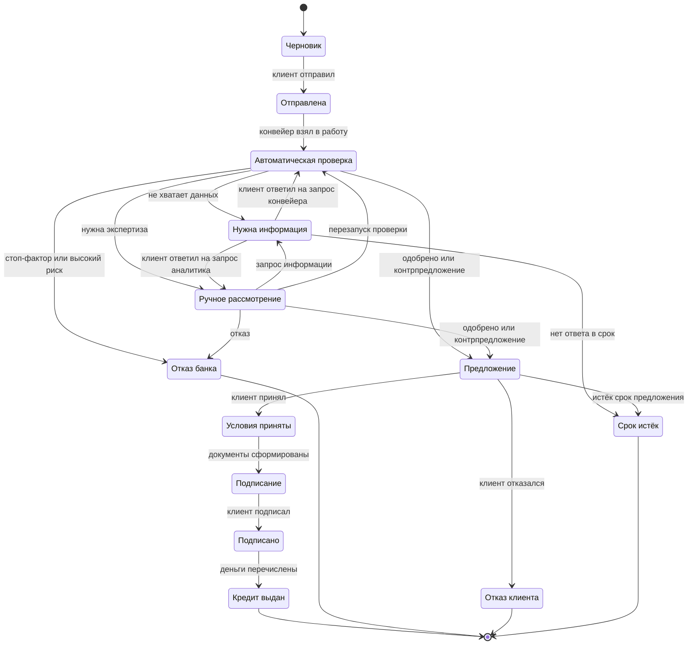

# Кредитный процесс

Модель процесса MVP: участники, этапы, статусы заявки, правила переходов, обработка сбоев и принятые упрощения. Логика скоринга и решения описана в [credit-policy.md](credit-policy.md).

## Границы процесса

- **Начало:** у предпринимателя появилась потребность в финансировании, и он открыл кабинет.
- **Конец:** кредит выдан (деньги перечислены, график платежей сформирован) или заявка завершена отказом, отзывом либо истечением срока.
- **Вне MVP:** обслуживание и погашение кредита, оценка залога, реальные электронная подпись, ЕСИА и платежи. Подробнее — в разделе «Упрощения».

## Участники

| Роль | Кто | Что делает |
|---|---|---|
| Клиент | Собственник, директор, бухгалтер или другой уполномоченный сотрудник ООО либо ИП | Подбирает продукт, заполняет и отправляет заявку, отвечает на запросы банка, принимает предложение, подписывает документы |
| Конвейер | Автоматическая обработка | Проверяет данные, запрашивает внешние источники, считает скоринг, применяет кредитную политику, формирует документы, проводит выдачу |
| Кредитный аналитик | Сотрудник банка | Рассматривает заявки, которые не решены автоматически: изучает досье, запрашивает информацию, принимает решение в пределах полномочий |
| Администратор | Сотрудник банка | Сбрасывает демо-данные, управляет сбоями симулятора; в развитии — каталог продуктов и параметры политики |

В MVP у каждой тестовой компании один пользователь с правом подписи. Разделение ролей внутри компании (готовит бухгалтер, подписывает директор) — в развитии.

## Этапы

| № | Этап | Исполнитель | Результат |
|---|---|---|---|
| 1 | Подбор продукта | Клиент | Выбран продукт, есть предварительный расчёт платежа |
| 2 | Заполнение заявки | Клиент | Черновик: компания (по ИНН), параметры, финансы и документы, согласия |
| 3 | Отправка | Клиент | Заявка принята в обработку |
| 4 | Проверка данных | Конвейер | Данные полные, корректные и приведены к единому виду, либо клиенту отправлен запрос информации |
| 5 | Сбор сведений | Конвейер | Получены сведения из ЕГРЮЛ/ЕГРИП, ФНС, отчётности, БКИ и внутренних данных банка |
| 6 | Скоринг | Конвейер | Балл, класс риска и вклад каждого фактора |
| 7 | Кредитное решение | Конвейер | Автоматическое решение или передача аналитику |
| 8 | Ручное рассмотрение | Аналитик | Одобрение, контрпредложение, запрос информации или отказ |
| 9 | Предложение | Клиент | Условия приняты или отклонены |
| 10 | Документы и подписание | Конвейер, клиент | Договор и график платежей сформированы и подписаны |
| 11 | Выдача | Конвейер | Кредит выдан, график платежей в кабинете |

## Дорожки процесса

```mermaid
flowchart LR
    subgraph client ["Клиент"]
        c1["Подбор продукта<br/>и расчёт платежа"]
        c2["Заявка и отправка:<br/>ИНН, параметры,<br/>документы, согласия"]
        c4["Ответ на запрос<br/>информации"]
        c5["Предложение: принять<br/>вариант или отказаться"]
        c6["Подпись договора<br/>паролем — ПЭП"]
    end
    subgraph system ["Система (конвейер)"]
        s1["Проверка данных"]
        s2["Сбор сведений"]
        s3["Скоринг: балл,<br/>класс риска, факторы"]
        s4["Кредитная политика:<br/>стоп-факторы, флаги,<br/>лимит, решение"]
        s6["Предложение или контрпредложение:<br/>класс A или B, нет флагов,<br/>сумма не больше автолимита"]
        s7["Отказ: стоп-фактор, класс E<br/>или лимит ниже минимума продукта.<br/>Причина простыми словами"]
        si["Запрос информации:<br/>нет данных, документов<br/>или источника финансов"]
        s8["Договор и график<br/>платежей в PDF"]
        s9["Выдача: ссудный счёт,<br/>перечисление, график<br/>платежей в кабинете"]
    end
    subgraph analyst ["Аналитик"]
        a1["Ручное рассмотрение:<br/>очередь, досье, решение<br/>в пределах полномочий"]
    end
    subgraph ext ["Внешние системы (симулятор)"]
        e1["ЕГРЮЛ / ЕГРИП, ФНС,<br/>ГИР БО, БКИ,<br/>обороты по счёту"]
        e6["АБС: ссудный счёт<br/>и перечисление"]
    end

    c1 --> c2
    c2 -- "заявка<br/>и согласия" --> s1
    s1 --> s2 --> s3 --> s4
    s1 --> si
    s2 <-- "запросы по ИНН,<br/>в БКИ — с согласием" --> e1
    s4 --> s6
    s4 --> s7
    s4 --> si
    s4 -- "флаги, класс C или D,<br/>сумма выше автолимита,<br/>залог" --> a1
    si -- "перечень<br/>и срок" --> c4
    c4 -- "ответ<br/>конвейеру" --> s1
    c4 -- "ответ<br/>аналитику" --> a1
    a1 -- "одобрить,<br/>изменить условия" --> s6
    a1 -- "запросить" --> si
    a1 -- "отказать" --> s7
    s6 -- "условия и<br/>объяснение" --> c5
    c5 -- "вариант" --> s8
    s8 -- "договор" --> c6
    c6 -- "подпись" --> s9
    s9 <-- "перечисление,<br/>подтверждение" --> e6
```

Те же этапы по участникам: кто что делает и что передаёт соседней дорожке. Внешние системы в MVP заменены симулятором ([architecture.md](architecture.md)), смысл обмена сохранён.

| Дорожка | Действия | Данные на входе | Результат |
|---|---|---|---|
| Клиент | Подбирает продукт, заполняет и отправляет заявку, отвечает на запросы, принимает предложение или отказывается, подписывает договор | Задача бизнеса, ИНН, сумма и срок, документы и согласия; предложения, запросы и причины отказа от банка | Отправленная заявка, ответ на запрос, принятый вариант условий, подписанный договор |
| Система (конвейер) | Проверяет данные, запрашивает источники, считает скоринг, применяет политику, формирует договор, проводит выдачу | Заявка с согласиями, ответы внешних систем, решение аналитика, подпись клиента | Автоматическое решение или передача аналитику; договор и график; выданный кредит |
| Аналитик | Разбирает свои заявки — они назначаются автоматически, срочные выше в очереди, — изучает досье, запрашивает информацию, принимает решение в пределах полномочий | Досье: источники, скоринг по факторам, расчёт лимита, флаги, документы, история, ответы клиента | Одобрение, контрпредложение, запрос информации, отказ; после сбоя источника — перезапуск проверки |
| Внешние системы (симулятор) | Отвечают на запросы конвейера; при включённом сбое — ошибка, тайм-аут или медленный ответ | ИНН компании, идентификатор согласия для БКИ, параметры кредита для выдачи | Сведения о компании, налогах, отчётности, кредитах и оборотах; подтверждение перечисления |

## Статусы заявки

Отдельно от схемы: до статуса «Подписано» клиент может в любой момент отозвать заявку. Тогда она переходит в статус «Отозвана» (`CANCELLED`). Черновик не отзывают, а удаляют.

| Код | Для клиента | Для банка | Что дальше |
|---|---|---|---|
| `DRAFT` | Черновик | — | Заполните и отправьте заявку |
| `SUBMITTED` | Заявка отправлена | Новая | Начинаем проверку |
| `IN_PROCESSING` | Проверяем заявку | Автоматическая обработка | Обычно это занимает несколько минут |
| `NEED_INFO` | Нужна информация | Ожидает клиента | Ответьте на запрос банка |
| `MANUAL_REVIEW` | Заявку рассматривает специалист | В очереди или у аналитика | Специалист изучает заявку |
| `OFFER` | Предложение готово | Предложение выдано | Примите условия или откажитесь |
| `ACCEPTED` | Готовим документы | Условия приняты | Документы появятся в кабинете |
| `SIGNING` | Подпишите документы | Ожидает подписи | Подпишите договор в кабинете |
| `SIGNED` | Документы подписаны | Подписано | Перечисляем деньги |
| `ISSUED` | Кредит выдан | Выдан | Смотрите график платежей |
| `REJECTED` | Банк отказал | Отказ | Причина и что можно сделать |
| `DECLINED` | Вы отказались от предложения | Отказ клиента | Можно подать новую заявку |
| `CANCELLED` | Заявка отозвана | Отозвана | Можно подать новую заявку |
| `EXPIRED` | Срок истёк | Истёк срок | Можно подать новую заявку |

## Правила переходов

| Из | В | Кто | Условие | Что происходит |
|---|---|---|---|---|
| `DRAFT` | `SUBMITTED` | Клиент | Обязательные поля заполнены, даны согласия на запрос в БКИ и обработку персональных данных | Фиксируется версия данных заявки, ставится задание конвейеру |
| `SUBMITTED` | `IN_PROCESSING` | Конвейер | Задание взято в работу | Запускаются шаги конвейера |
| `IN_PROCESSING` | `NEED_INFO` | Конвейер | Не хватает данных или документов | Клиенту приходит запрос с перечнем и сроком |
| `IN_PROCESSING` | `MANUAL_REVIEW` | Конвейер | Флаги политики, класс риска C/D, сумма выше автолимита, недоступный источник | Заявка попадает в очередь аналитиков и сразу назначается одному из них (см. «Очередь аналитиков») |
| `IN_PROCESSING` | `OFFER` | Конвейер | Класс A/B без флагов | Формируется предложение: как запрошено или контрпредложение |
| `IN_PROCESSING` | `REJECTED` | Конвейер | Стоп-фактор или класс риска E | Клиент видит причину простыми словами |
| `NEED_INFO` | `IN_PROCESSING` | Клиент | Ответ на запрос конвейера | Конвейер повторяет проверку с новыми данными |
| `NEED_INFO` | `MANUAL_REVIEW` | Клиент | Ответ на запрос аналитика | Заявка возвращается тому же аналитику |
| `NEED_INFO` | `EXPIRED` | Таймер | Срок ответа истёк | Заявка закрывается |
| `MANUAL_REVIEW` | `OFFER` | Аналитик | Решение в пределах полномочий | Формируется предложение |
| `MANUAL_REVIEW` | `NEED_INFO` | Аналитик | Нужны документы или пояснения | Клиенту приходит запрос |
| `MANUAL_REVIEW` | `REJECTED` | Аналитик | Указаны код причины и комментарий | Клиент видит причину |
| `MANUAL_REVIEW` | `IN_PROCESSING` | Аналитик | Заявка ушла к аналитику из-за недоступного источника, источник восстановился | Конвейер заново запрашивает источники и пересчитывает решение (новый прогон с увеличенным номером) |
| `OFFER` | `ACCEPTED` | Клиент | Выбран вариант, предложение действует | Запускается формирование документов |
| `OFFER` | `DECLINED` | Клиент | — | Заявка закрывается |
| `OFFER` | `EXPIRED` | Таймер | Срок предложения истёк | Заявка закрывается |
| `ACCEPTED` | `SIGNING` | Конвейер | Договор и график сформированы | Документы появляются в кабинете |
| `SIGNING` | `SIGNED` | Клиент | Подтверждение подписи паролем | Банк подписывает автоматически, ставится задание на выдачу |
| `SIGNED` | `ISSUED` | Конвейер | Симулятор подтвердил перечисление | Создаются кредит и график платежей |
| Любой активный до `SIGNED` | `CANCELLED` | Клиент | — | Заявка закрывается, текущие задания снимаются |

Общие правила:
- **Единая точка смены статуса.** Все переходы проходят через один сервис, недопустимый переход отклоняется. Смена статуса, запись в историю, журнал действий и событие для обработчика сохраняются в одной транзакции.
- **Версия заявки (оптимистическая блокировка).** Если аналитик принимает решение, а клиент в это же время отзывает заявку, пройдёт только первое действие. Второй участник увидит, что заявка изменилась.
- **Идемпотентность.** Отправка и подписание идемпотентны (`Idempotency-Key`): повторное нажатие или повтор запроса не создают дубликатов.

## Шаги конвейера

Пока идёт статус «Автоматическая проверка», конвейер последовательно выполняет шаги. Клиент видит их прогресс, банк — подробности по каждому шагу.

| Шаг | Источник | Что получаем или проверяем | Если не получилось |
|---|---|---|---|
| Проверка данных | Заявка | Обязательные поля, контрольные суммы ИНН и ОГРН, сумма и срок в пределах продукта, согласия, обязательные документы | «Нужна информация» с перечнем недостающего |
| ЕГРЮЛ / ЕГРИП | Симулятор | Существование и статус компании, дата регистрации, ОКВЭД, руководитель и дата назначения, адрес | Повторы, затем ожидание источника |
| ФНС «Прозрачный бизнес» | Симулятор | Налоговая задолженность, массовый адрес, дисквалификация руководителя, численность, налоговый режим | То же |
| Отчётность (ГИР БО) | Симулятор | Выручка, прибыль от продаж и чистая прибыль за два последних года. Только для ООО | Для ИП шаг пропускается, финансы берутся из оборотов по счёту или выписки |
| БКИ | Симулятор | Действующие кредиты и платежи по ним, просрочки за 24 месяца, текущая просрочка | Повторы, затем ожидание источника |
| Внутренние данные банка | Симулятор | Поступления на расчётный счёт за 12 месяцев, срок обслуживания | Не клиент банка — шаг пропускается |
| Скоринг | Модуль `scoring` | Балл, класс риска, вклад факторов | Ручное рассмотрение |
| Кредитная политика | Модуль `policy` | Стоп-факторы, флаги, лимит, решение | Ручное рассмотрение |

**Обработка сбоев внешних источников:**
- Каждый вызов ограничен таймаутом.
- При ошибке шаг повторяется с растущей паузой.
- Если источник падает массово, вызовы к нему на время приостанавливаются (circuit breaker), чтобы не перегружать его.
- Пока источник недоступен, заявка остаётся в статусе «Автоматическая проверка». Клиент видит «Ждём ответа от бюро кредитных историй». Банк видит заявку в списке сбоев конвейера и может повторить шаг вручную.
- Когда источник восстанавливается, обработка продолжается с того же шага.
- Если ожидание превысило лимит, заявка уходит на ручное рассмотрение с пометкой «источник недоступен» (флаг F05). Когда источник восстановится, аналитик перезапускает автоматическую проверку из досье, и конвейер проходит шаги заново.

## Таймеры

Значения задаются в настройках ([`config.py`](../backend/app/config.py)), порог срочности — в правилах приоритета ([`domain/review.py`](../backend/app/domain/review.py)).

| Таймер | Значение в демо | Ориентир для боевой работы | Что происходит |
|---|---|---|---|
| Ответ на запрос информации | 3 дня | 5 рабочих дней | Статус «Срок истёк» |
| Срок действия предложения | 7 дней | 30 дней | Статус «Срок истёк» |
| Срок ручного рассмотрения | 1 день | 1 рабочий день | Подсветка в очереди, после срока — высокий приоритет |
| Порог срочности рассмотрения | 4 часа до конца срока | 4 рабочих часа | Высокий приоритет: заявка поднимается в начало очереди |
| Ожидание внешнего источника | 15 минут | 24 часа | Ручное рассмотрение с пометкой |

## Очередь аналитиков

Заявки на ручном рассмотрении не ждут, пока их кто-нибудь возьмёт: при переходе в `MANUAL_REVIEW` заявка сразу получает исполнителя, а в очереди у неё есть приоритет с причинами. Правила простые, чтобы аналитик понимал, почему заявка выше или ниже соседней.

**Приоритет** считается при каждом запросе очереди или досье из срока рассмотрения, суммы и флагов политики, ничего не хранится. Только для заявок в `MANUAL_REVIEW`, у остальных его нет.

| Приоритет | Когда | Причина в интерфейсе |
|---|---|---|
| Высокий (`HIGH`) | Срок рассмотрения истёк | «Срок рассмотрения истёк» |
| | До конца срока меньше 4 часов | «До конца срока меньше 4 часов» |
| Средний (`MEDIUM`) | Сумма от 10 млн ₽ | «Сумма от 10 млн ₽» |
| | Есть флаги, по которым аналитику нужно что-то проверить или запросить у клиента: F01 массовый адрес, F02 налоговая задолженность, F03 недавняя смена руководителя, F04 расхождение выручки, F06 текущая просрочка | «Флаги F01, F02 требуют проверки» |
| Обычный (`NORMAL`) | Ничего из перечисленного | — |
| | Флаг F05: источник не ответил за отведённое время. Пока он не восстановится, аналитику делать нечего — затем он перезапускает проверку. Правило важнее остальных: срок и сумма не поднимают приоритет | «Ждём ответа источника» |

- Флаг F07 (класс риска C или D) приоритет не повышает: это оценка риска, а не конкретный вопрос, по ней аналитик решает в обычном порядке.
- У высокого приоритета причины перечислены все: сначала срок, затем сумма и флаги.
- Порядок очереди: сначала ручное рассмотрение — высокий, средний, обычный приоритет, внутри приоритета ближайший срок рассмотрения выше; затем автоматическая проверка, ожидание клиента и остальные статусы — по времени смены статуса.
- В очереди приоритет — отдельная колонка с бейджем (красный, оранжевый, серый), причины — во всплывающей подсказке; на телефоне колонка скрыта. В шапке досье — тот же бейдж и причины списком.

**Автораспределение.** Заявка, перешедшая в `MANUAL_REVIEW` без исполнителя, назначается аналитику (роль `UNDERWRITER`), у которого сейчас меньше всего заявок на ручном рассмотрении; при равенстве — первому по логину (`analyst` раньше `analyst2`). Администратор заявки не получает.

- Назначение происходит в той же транзакции, что и смена статуса ([`services/workflow.py`](../backend/app/services/workflow.py)). На время выбора строки аналитиков блокируются, поэтому заявки, одновременно пришедшие в разных потоках обработчика, распределяются по очереди и не достаются обе одному аналитику.
- В журнал пишется `ASSIGNED` с деталями `{"auto": true, "to": "<логин>"}`, назначенный аналитик получает личное уведомление «Вам назначена заявка № …» — остальные сотрудники его не видят.
- Заявка, у которой исполнитель уже есть, остаётся у него: она вернулась после ответа клиента на запрос аналитика или после перезапуска проверки.
- Стартовые заявки сброса демо-данных распределяются тем же правилом сразу при сбросе, по порядку номеров: «Вектор Логистик» — `analyst`, «Гранд Девелопмент» — `analyst2`. Конвейер ведёт их параллельно, и без этого исполнитель зависел бы от того, какая заявка первой дойдёт до ручного рассмотрения.
- `AUTO_ASSIGN=false` выключает автораспределение: заявки ждут в общей очереди, пока аналитик не возьмёт их сам, как раньше.

**Взять в работу и взять себе.** В шапке досье у ничьей заявки — кнопка «Взять в работу», у заявки другого аналитика — «Взять себе»: она переходит к нажавшему, в журнал пишется `ASSIGNED` с `{"from": "<логин>", "to": "<логин>"}`, у остальных сотрудников очередь и досье обновляются сами. У своей заявки кнопки нет. Решение или запрос информации по ничьей заявке тоже назначают её на сотрудника, который действует.

## Уведомления

Все уведомления приходят только в продукте: лента событий, счётчик и обновление страницы без перезагрузки. Email, SMS, мессенджеры и звонки в сценарии не используются.

| Событие | Кому |
|---|---|
| Заявка отправлена | Клиенту |
| Запрос информации | Клиенту |
| Ответ клиента на запрос | Аналитику |
| Предложение готово / отказ | Клиенту |
| Документы готовы к подписанию | Клиенту |
| Кредит выдан | Клиенту |
| Новое сообщение в чате | Клиенту или аналитику |
| Новая заявка на ручное рассмотрение | Аналитикам |
| Заявка назначена автоматически | Назначенному аналитику (личное уведомление) |

## Упрощения

Допущения сохраняют смысл и связность процесса (ТЗ, стр. 11).

- **Подписание.** Простая электронная подпись смоделирована в продукте: клиент подтверждает подписание повторным вводом пароля. Сохраняются хэш документа, время и пользователь. Реальной ЭЦП и SMS-кодов нет.
- **Выдача.** Симулятор банковской системы «открывает» ссудный счёт и «перечисляет» деньги без реальных операций.
- **Внешние источники.** ЕГРЮЛ/ЕГРИП, ФНС, ГИР БО, БКИ и внутренние данные банка заменены симулятором с синтетическими данными. Контракты упрощены, смысл интеграций сохранён.
- **Залог.** Клиент заявляет тип и оценочную стоимость, оценка и проверка залога не моделируются.
- **Пользователи.** Один пользователь на компанию, вход по логину и паролю вместо ЕСИА.
- **Расчёты.** Только рубли и аннуитетные платежи. Для овердрафта и кредитной линии расчёт упрощён до лимита и ставки.
- **Скоринг.** Балльная карта на явных правилах. Организаторы допускают упрощённую логику решения.

## Правовые основания и допущения

Прототип не является банковским продуктом, но процесс сверен с нормами, которые затрагивает кредитование бизнеса. В таблице — что учтено в модели процесса, что смоделировано и что сознательно не реализовано. Правовые аспекты ИИ-помощника — в [ai.md](ai.md#ответственное-применение-ии); продукты, ставки и пороги синтетические и не являются офертой ([credit-policy.md](credit-policy.md)).

| Норма | Где в процессе | Как учтено | Упрощение в прототипе |
|---|---|---|---|
| 218-ФЗ «О кредитных историях» | Этап 3 «Отправка», шаг конвейера «БКИ» | Без согласия на запрос кредитной истории заявка не отправляется (ответ 422). Согласие хранится в таблице `consents`: кто дал, когда, версия текста. Его идентификатор передаётся в запрос к БКИ, без него симулятор отвечает ошибкой | Текст согласия — короткая формулировка в кабинете, а не полный документ. Срок действия согласия и передача сведений о выданном кредите в бюро не моделируются |
| 152-ФЗ «О персональных данных» | Этап 3 «Отправка»; хранение данных руководителя и представителя компании | Отдельное согласие на обработку персональных данных обязательно для отправки и хранится так же. Перечень полей с персональными данными и меры защиты — в [data-model.md](data-model.md#персональные-данные); в модель ИИ имена, ИНН и контакты не передаются | Все данные синтетические. Отзыв согласия, сроки хранения и уничтожения данных, политика обработки не реализованы |
| 63-ФЗ «Об электронной подписи» | Этап 10 «Документы и подписание» | Договор подписывается простой электронной подписью (ПЭП): пользователь с правом подписи подтверждает подписание паролем; сохраняются SHA-256 документа, время, пользователь и способ подписи; подпись банка проставляется автоматически. Оговорка о ПЭП есть в тексте договора | УКЭП не реализована (см. «Упрощения»). Соглашение сторон об использовании ПЭП, которое по закону придаёт ей силу собственноручной подписи, не оформляется — допущение |
| 115-ФЗ «О противодействии легализации (отмыванию) доходов…» | Шаги конвейера «ЕГРЮЛ / ЕГРИП» и «ФНС»; стоп-факторы `S01`, `S02`, флаги `F01`, `F03` | Смоделированы проверки статуса компании (ликвидация, реорганизация, банкротство), руководителя (дисквалификация, недавняя смена) и адреса массовой регистрации по данным симулятора — с отказом или передачей аналитику | Полноценный контроль ПОД/ФТ не реализован: идентификация клиента и бенефициарных владельцев, проверка по перечням Росфинмониторинга, оценка уровня риска клиента — допущение |
| 353-ФЗ «О потребительском кредите (займе)» | Этапы 1–2: подбор продукта и заявка | Не применяется: заёмщик — ООО или ИП, цель кредита — задача бизнеса, она фиксируется в заявке. Ставка, платёж и переплата показываются до заявки по продуктовому решению, а не по требованию закона | Допущение: все кредиты — на цели предпринимательской деятельности; кредиты ИП на личные нужды не рассматриваются |
| Положение Банка России № 590-П о резервах на возможные потери по ссудам | Этап 6 «Скоринг», классы риска A–E | Классы риска с условной вероятностью дефолта (от ~1 % для A до более 20 % для E) используются для надбавки к ставке и пояснений ([credit-policy.md](credit-policy.md#скоринговая-карта)) | Это не категории качества ссуд и не расчёт резерва: классификация ссуд, оценка финансового положения заёмщика и качества обслуживания долга по Положению не реализованы — допущение |
