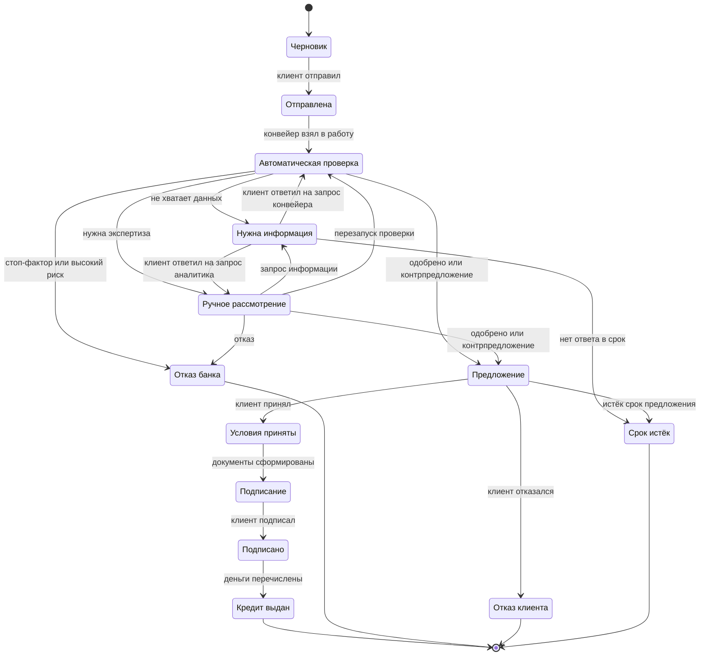

# Кредитный процесс

Модель процесса MVP: участники, этапы, статусы заявки, правила переходов, обработка сбоев и принятые упрощения. Логика скоринга и решения описана в [credit-policy.md](credit-policy.md).

## Границы процесса

- **Начало:** у предпринимателя появилась потребность в финансировании, и он открыл кабинет.
- **Конец:** кредит выдан (деньги перечислены, график платежей сформирован) или заявка завершена отказом, отзывом либо истечением срока.
- **Вне MVP:** обслуживание и погашение кредита, оценка залога, реальные электронная подпись, ЕСИА и платежи. Подробнее — в разделе «Упрощения».

## Участники

| Роль | Кто | Что делает |
|---|---|---|
| Клиент | Собственник, директор, бухгалтер или другой уполномоченный сотрудник ООО либо ИП | Подбирает продукт, заполняет и отправляет заявку, отвечает на запросы банка, принимает предложение, подписывает документы |
| Конвейер | Автоматическая обработка | Проверяет данные, запрашивает внешние источники, считает скоринг, применяет кредитную политику, формирует документы, проводит выдачу |
| Кредитный аналитик | Сотрудник банка | Рассматривает заявки, которые не решены автоматически: изучает досье, запрашивает информацию, принимает решение в пределах полномочий |
| Администратор | Сотрудник банка | Сбрасывает демо-данные, управляет сбоями симулятора; в развитии — каталог продуктов и параметры политики |

В MVP у каждой тестовой компании один пользователь с правом подписи. Разделение ролей внутри компании (готовит бухгалтер, подписывает директор) — в развитии.

## Этапы

| № | Этап | Исполнитель | Результат |
|---|---|---|---|
| 1 | Подбор продукта | Клиент | Выбран продукт, есть предварительный расчёт платежа |
| 2 | Заполнение заявки | Клиент | Черновик: компания (по ИНН), параметры, финансы и документы, согласия |
| 3 | Отправка | Клиент | Заявка принята в обработку |
| 4 | Проверка данных | Конвейер | Данные полные, корректные и приведены к единому виду, либо клиенту отправлен запрос информации |
| 5 | Сбор сведений | Конвейер | Получены сведения из ЕГРЮЛ/ЕГРИП, ФНС, отчётности, БКИ и внутренних данных банка |
| 6 | Скоринг | Конвейер | Балл, класс риска и вклад каждого фактора |
| 7 | Кредитное решение | Конвейер | Автоматическое решение или передача аналитику |
| 8 | Ручное рассмотрение | Аналитик | Одобрение, контрпредложение, запрос информации или отказ |
| 9 | Предложение | Клиент | Условия приняты или отклонены |
| 10 | Документы и подписание | Конвейер, клиент | Договор и график платежей сформированы и подписаны |
| 11 | Выдача | Конвейер | Кредит выдан, график платежей в кабинете |

## Статусы заявки

Отдельно от схемы: до статуса «Подписано» клиент может в любой момент отозвать заявку. Тогда она переходит в статус «Отозвана» (`CANCELLED`). Черновик не отзывают, а удаляют.

| Код | Для клиента | Для банка | Что дальше |
|---|---|---|---|
| `DRAFT` | Черновик | — | Заполните и отправьте заявку |
| `SUBMITTED` | Заявка отправлена | Новая | Начинаем проверку |
| `IN_PROCESSING` | Проверяем заявку | Автоматическая обработка | Обычно это занимает несколько минут |
| `NEED_INFO` | Нужна информация | Ожидает клиента | Ответьте на запрос банка |
| `MANUAL_REVIEW` | Заявку рассматривает специалист | В очереди или у аналитика | Специалист изучает заявку |
| `OFFER` | Предложение готово | Предложение выдано | Примите условия или откажитесь |
| `ACCEPTED` | Готовим документы | Условия приняты | Документы появятся в кабинете |
| `SIGNING` | Подпишите документы | Ожидает подписи | Подпишите договор в кабинете |
| `SIGNED` | Документы подписаны | Подписано | Перечисляем деньги |
| `ISSUED` | Кредит выдан | Выдан | Смотрите график платежей |
| `REJECTED` | Банк отказал | Отказ | Причина и что можно сделать |
| `DECLINED` | Вы отказались от предложения | Отказ клиента | Можно подать новую заявку |
| `CANCELLED` | Заявка отозвана | Отозвана | Можно подать новую заявку |
| `EXPIRED` | Срок истёк | Истёк срок | Можно подать новую заявку |

## Правила переходов

| Из | В | Кто | Условие | Что происходит |
|---|---|---|---|---|
| `DRAFT` | `SUBMITTED` | Клиент | Обязательные поля заполнены, даны согласия на запрос в БКИ и обработку персональных данных | Фиксируется версия данных заявки, ставится задание конвейеру |
| `SUBMITTED` | `IN_PROCESSING` | Конвейер | Задание взято в работу | Запускаются шаги конвейера |
| `IN_PROCESSING` | `NEED_INFO` | Конвейер | Не хватает данных или документов | Клиенту приходит запрос с перечнем и сроком |
| `IN_PROCESSING` | `MANUAL_REVIEW` | Конвейер | Флаги политики, класс риска C/D, сумма выше автолимита, недоступный источник | Заявка попадает в очередь аналитиков |
| `IN_PROCESSING` | `OFFER` | Конвейер | Класс A/B без флагов | Формируется предложение: как запрошено или контрпредложение |
| `IN_PROCESSING` | `REJECTED` | Конвейер | Стоп-фактор или класс риска E | Клиент видит причину простыми словами |
| `NEED_INFO` | `IN_PROCESSING` | Клиент | Ответ на запрос конвейера | Конвейер повторяет проверку с новыми данными |
| `NEED_INFO` | `MANUAL_REVIEW` | Клиент | Ответ на запрос аналитика | Заявка возвращается тому же аналитику |
| `NEED_INFO` | `EXPIRED` | Таймер | Срок ответа истёк | Заявка закрывается |
| `MANUAL_REVIEW` | `OFFER` | Аналитик | Решение в пределах полномочий | Формируется предложение |
| `MANUAL_REVIEW` | `NEED_INFO` | Аналитик | Нужны документы или пояснения | Клиенту приходит запрос |
| `MANUAL_REVIEW` | `REJECTED` | Аналитик | Указаны код причины и комментарий | Клиент видит причину |
| `MANUAL_REVIEW` | `IN_PROCESSING` | Аналитик | Заявка ушла к аналитику из-за недоступного источника, источник восстановился | Конвейер заново запрашивает источники и пересчитывает решение (новый прогон с увеличенным номером) |
| `OFFER` | `ACCEPTED` | Клиент | Выбран вариант, предложение действует | Запускается формирование документов |
| `OFFER` | `DECLINED` | Клиент | — | Заявка закрывается |
| `OFFER` | `EXPIRED` | Таймер | Срок предложения истёк | Заявка закрывается |
| `ACCEPTED` | `SIGNING` | Конвейер | Договор и график сформированы | Документы появляются в кабинете |
| `SIGNING` | `SIGNED` | Клиент | Подтверждение подписи паролем | Банк подписывает автоматически, ставится задание на выдачу |
| `SIGNED` | `ISSUED` | Конвейер | Симулятор подтвердил перечисление | Создаются кредит и график платежей |
| Любой активный до `SIGNED` | `CANCELLED` | Клиент | — | Заявка закрывается, текущие задания снимаются |

Общие правила:
- **Единая точка смены статуса.** Все переходы проходят через один сервис, недопустимый переход отклоняется. Смена статуса, запись в историю, журнал действий и событие для обработчика сохраняются в одной транзакции.
- **Версия заявки (оптимистическая блокировка).** Если аналитик принимает решение, а клиент в это же время отзывает заявку, пройдёт только первое действие. Второй участник увидит, что заявка изменилась.
- **Идемпотентность.** Отправка и подписание идемпотентны (`Idempotency-Key`): повторное нажатие или повтор запроса не создают дубликатов.

## Шаги конвейера

Пока идёт статус «Автоматическая проверка», конвейер последовательно выполняет шаги. Клиент видит их прогресс, банк — подробности по каждому шагу.

| Шаг | Источник | Что получаем или проверяем | Если не получилось |
|---|---|---|---|
| Проверка данных | Заявка | Обязательные поля, контрольные суммы ИНН и ОГРН, сумма и срок в пределах продукта, согласия, обязательные документы | «Нужна информация» с перечнем недостающего |
| ЕГРЮЛ / ЕГРИП | Симулятор | Существование и статус компании, дата регистрации, ОКВЭД, руководитель и дата назначения, адрес | Повторы, затем ожидание источника |
| ФНС «Прозрачный бизнес» | Симулятор | Налоговая задолженность, массовый адрес, дисквалификация руководителя, численность, налоговый режим | То же |
| Отчётность (ГИР БО) | Симулятор | Выручка, прибыль от продаж и чистая прибыль за два последних года. Только для ООО | Для ИП шаг пропускается, финансы берутся из оборотов по счёту или выписки |
| БКИ | Симулятор | Действующие кредиты и платежи по ним, просрочки за 24 месяца, текущая просрочка | Повторы, затем ожидание источника |
| Внутренние данные банка | Симулятор | Поступления на расчётный счёт за 12 месяцев, срок обслуживания | Не клиент банка — шаг пропускается |
| Скоринг | Модуль `scoring` | Балл, класс риска, вклад факторов | Ручное рассмотрение |
| Кредитная политика | Модуль `policy` | Стоп-факторы, флаги, лимит, решение | Ручное рассмотрение |

**Обработка сбоев внешних источников:**
- Каждый вызов ограничен таймаутом.
- При ошибке шаг повторяется с растущей паузой.
- Если источник падает массово, вызовы к нему на время приостанавливаются (circuit breaker), чтобы не перегружать его.
- Пока источник недоступен, заявка остаётся в статусе «Автоматическая проверка». Клиент видит «Ждём ответа от бюро кредитных историй». Банк видит заявку в списке сбоев конвейера и может повторить шаг вручную.
- Когда источник восстанавливается, обработка продолжается с того же шага.
- Если ожидание превысило лимит, заявка уходит на ручное рассмотрение с пометкой «источник недоступен» (флаг F05). Когда источник восстановится, аналитик перезапускает автоматическую проверку из досье, и конвейер проходит шаги заново.

## Таймеры

Значения задаются в настройках.

| Таймер | Значение в демо | Ориентир для боевой работы | Что происходит |
|---|---|---|---|
| Ответ на запрос информации | 3 дня | 5 рабочих дней | Статус «Срок истёк» |
| Срок действия предложения | 7 дней | 30 дней | Статус «Срок истёк» |
| Срок ручного рассмотрения | 1 день | 1 рабочий день | Подсветка в очереди |
| Ожидание внешнего источника | 15 минут | 24 часа | Ручное рассмотрение с пометкой |

## Уведомления

Все уведомления приходят только в продукте: лента событий, счётчик и обновление страницы без перезагрузки. Email, SMS, мессенджеры и звонки в сценарии не используются.

| Событие | Кому |
|---|---|
| Заявка отправлена | Клиенту |
| Запрос информации | Клиенту |
| Ответ клиента на запрос | Аналитику |
| Предложение готово / отказ | Клиенту |
| Документы готовы к подписанию | Клиенту |
| Кредит выдан | Клиенту |
| Новое сообщение в чате | Клиенту или аналитику |
| Новая заявка на ручное рассмотрение | Аналитикам |

## Упрощения

Допущения сохраняют смысл и связность процесса (ТЗ, стр. 11).

- **Подписание.** Простая электронная подпись смоделирована в продукте: клиент подтверждает подписание повторным вводом пароля. Сохраняются хэш документа, время и пользователь. Реальной ЭЦП и SMS-кодов нет.
- **Выдача.** Симулятор банковской системы «открывает» ссудный счёт и «перечисляет» деньги без реальных операций.
- **Внешние источники.** ЕГРЮЛ/ЕГРИП, ФНС, ГИР БО, БКИ и внутренние данные банка заменены симулятором с синтетическими данными. Контракты упрощены, смысл интеграций сохранён.
- **Залог.** Клиент заявляет тип и оценочную стоимость, оценка и проверка залога не моделируются.
- **Пользователи.** Один пользователь на компанию, вход по логину и паролю вместо ЕСИА.
- **Расчёты.** Только рубли и аннуитетные платежи. Для овердрафта и кредитной линии расчёт упрощён до лимита и ставки.
- **Скоринг.** Балльная карта на явных правилах. Организаторы допускают упрощённую логику решения.
