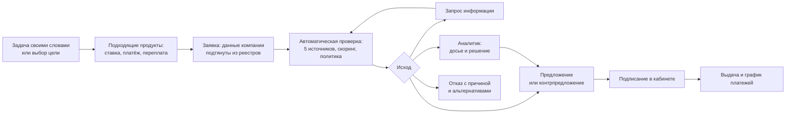
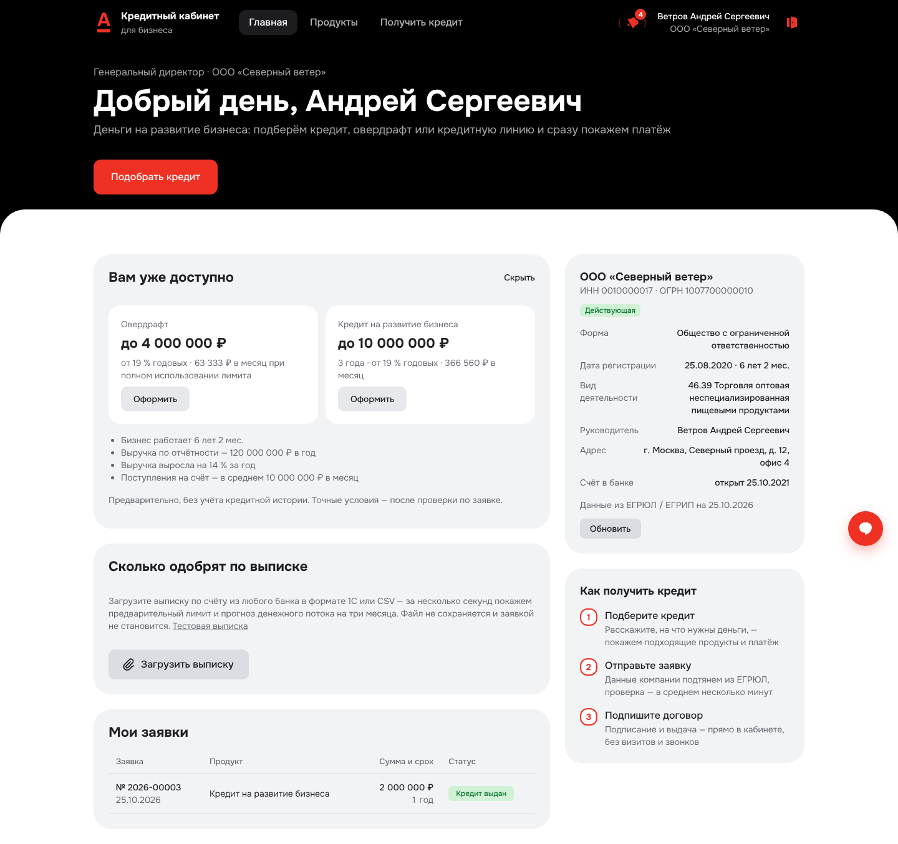
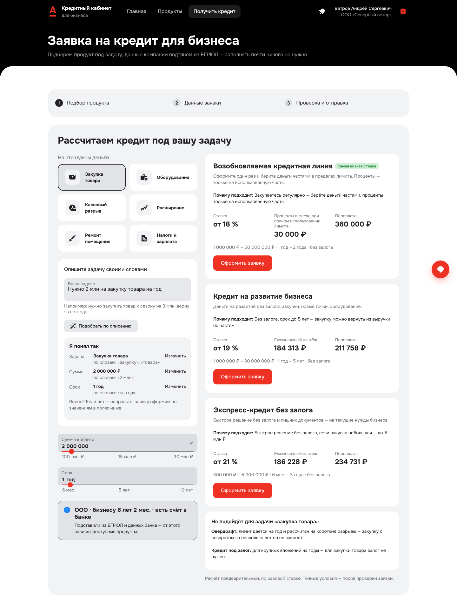
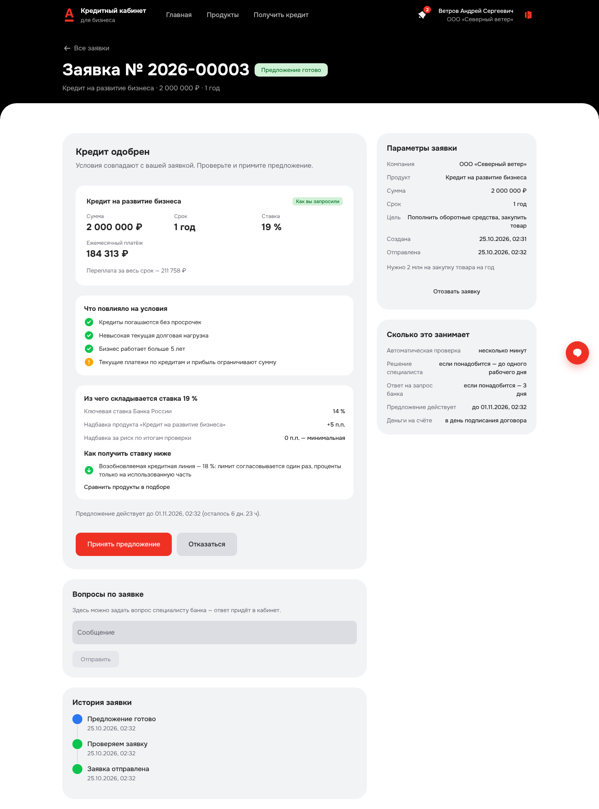
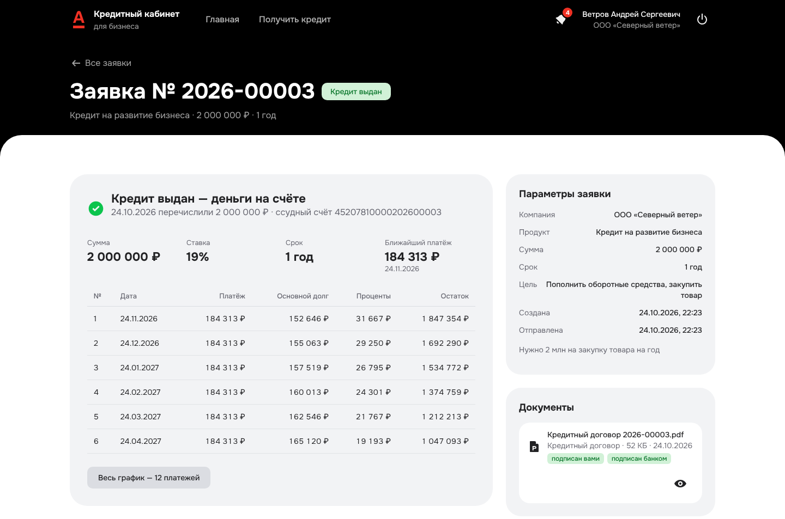
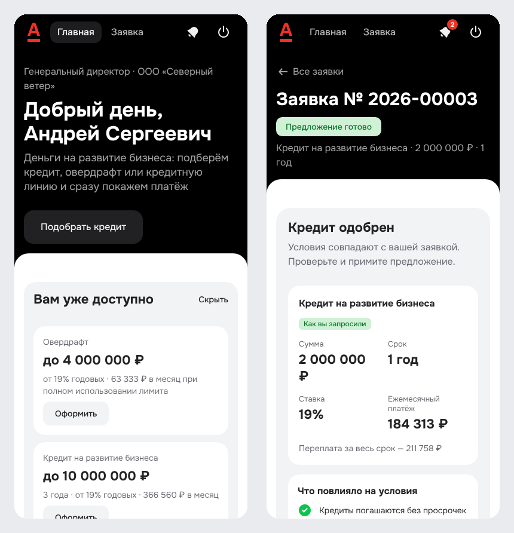
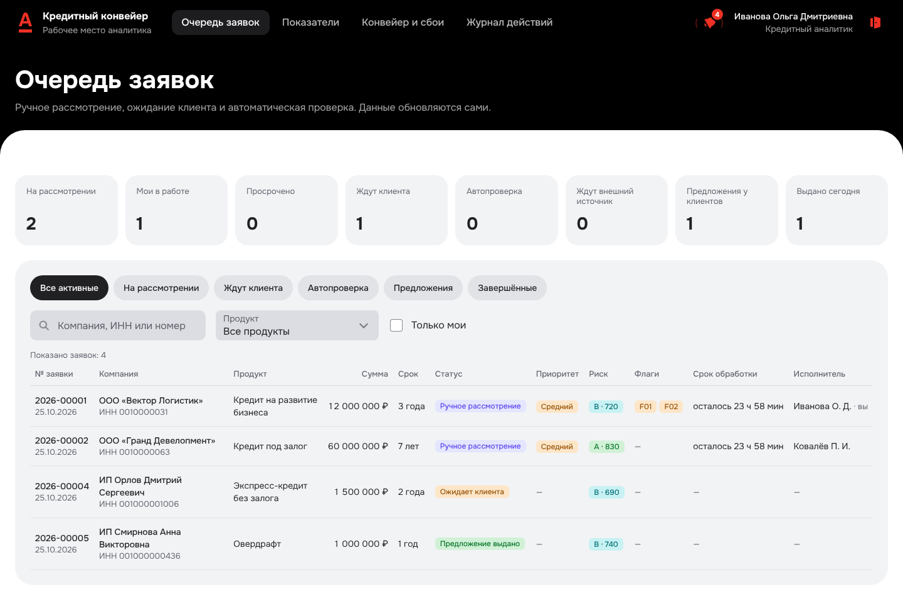
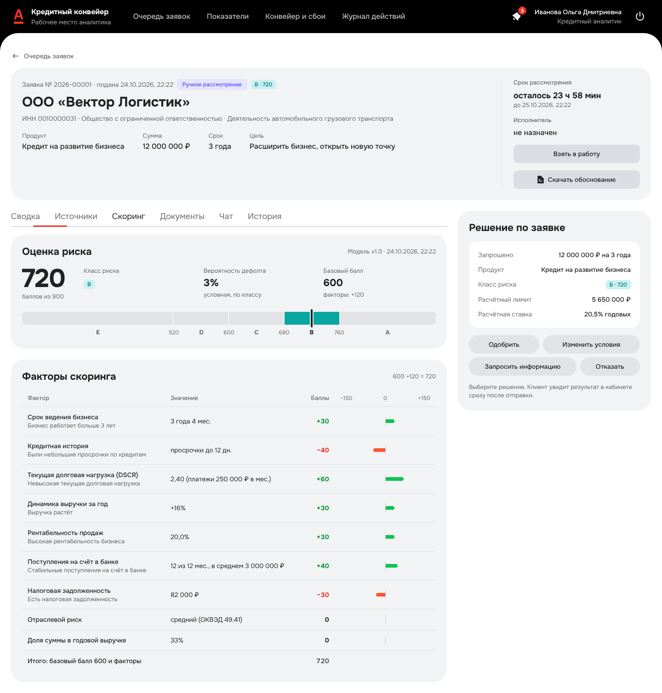
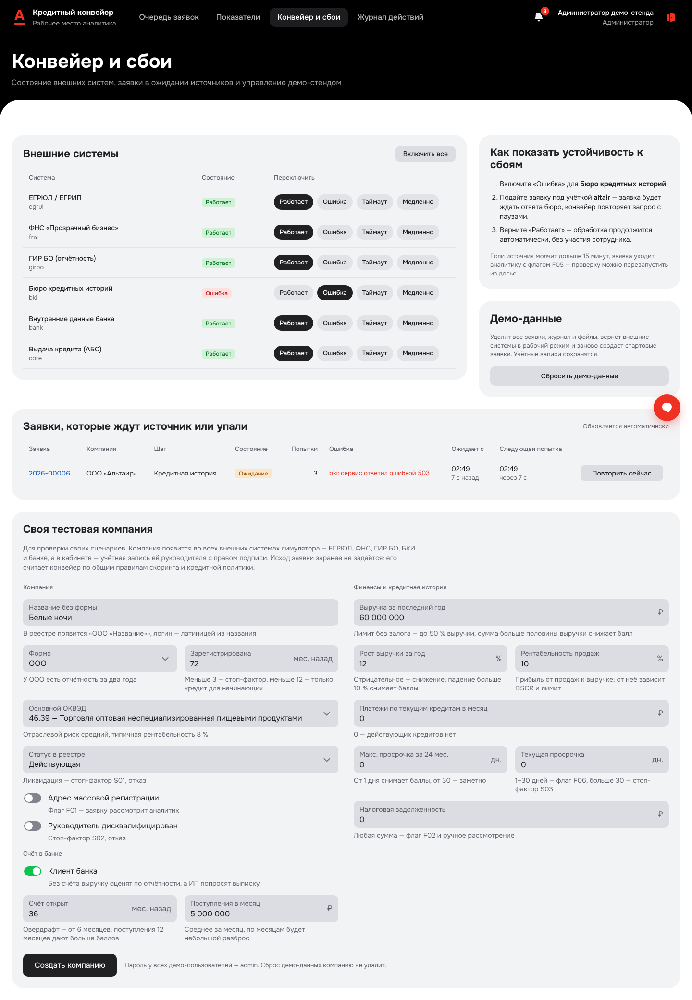

# Продукт за пять минут: возможности, исследование и его влияние на решение

Короткий обзор для тех, кто оценивает продукт, а не код: что умеет кабинет, на каких выводах исследования это
построено и чем решение отличается от «онлайн-анкеты с ответом за минуту». Технические подробности — в
остальных документах, ссылки даны по ходу. Посмотреть вживую: [демо-версия без сервера](https://stonebridgeway.github.io/alfa-hakaton/)
(логин `veter`, пароль `demo`) или стенд по [README](../README.md#запуск).

## Для кого и зачем

**Предприниматель** малого или микробизнеса — собственник, директор, финансовый директор или бухгалтер ООО либо ИП.
Деньги нужны под задачу: закупка к сезону, кассовый разрыв, оборудование, новая точка. Банковской экспертизы нет,
времени мало, а главный вопрос — «сколько реально одобрят, под какую ставку и когда деньги будут на счёте».

**Банк** — кредитный аналитик, который разбирает нестандартные заявки, и руководитель процесса. Банку нужно решать
типовые заявки автоматически по прозрачным правилам, не терять контроль над риском и видеть, как работает конвейер.

Кабинет клиента и рабочее место аналитика связаны одной заявкой и одним процессом: от потребности бизнеса до выдачи
кредита и графика платежей. Весь путь на стенде занимает около полуминуты ([GIF в README](../README.md#как-это-выглядит)).

## Три отличия от того, что уже есть на рынке

Онлайн-заявка, решение за минуты и подписание без визита у банков уже есть. Кабинетное исследование показало, где
путь предпринимателя ломается на самом деле, и прототип построен вокруг трёх ответов на это
([подробнее](research/desk-research.md#что-это-значит-для-решения)):

1. **Подбор от задачи бизнеса, а не от названия продукта.** Клиент описывает, на что нужны деньги, — система подбирает
   типы финансирования, объясняет различия и показывает платёж и переплату до заявки.
2. **Единое кредитное досье.** Реквизиты из реестров, документы в одном месте, история запросов банка, видно, что уже
   есть и чего не хватает, — и клиенту, и аналитику.
3. **Объяснимое решение и альтернатива.** Вместо «отказано» — причина, что поможет и какой продукт подойдёт; вместо
   «одобрили меньше» — контрпредложение с объяснением и выбором варианта.

## Что умеет кабинет клиента

| | |
|---|---|
|  |  |
| Главная: «Вам уже доступно» по данным компании, «Сколько одобрят по выписке» без заявки, заявки и кредиты | Подбор: описание своими словами разобрано в цель, сумму и срок; продукты от меньшей ставки к большей |

- **Предложение до заявки.** На главной клиент видит, что банк готов дать уже сейчас: овердрафт и кредит с суммой по
  тем же правилам кредитной политики, с пометкой «предварительно, без учёта кредитной истории» и объяснением «на чём
  основано». Переход в заявку предзаполняет цель, сумму и срок.
- **«Сколько одобрят по выписке».** Если данных в банке мало, клиент загружает выписку из другого банка прямо на
  главной и за секунды видит предварительный лимит и прогноз кассового разрыва на три месяца. Файл не сохраняется,
  заявка не создаётся — это ответ на главный вопрос до анкеты.
- **Подбор по задаче.** Первый экран — «На что нужны деньги» и поле «Опишите задачу своими словами». Разбор работает на
  правилах, при желании подключается модель ([ai.md](ai.md)). Под задачу показываются подходящие продукты с ставкой,
  платежом и переплатой; у недоступных — почему («доступен бизнесу от 1 года»). У продуктов нет комиссий и подписок.
- **Заявка почти без ввода.** Реквизиты, статус, руководитель и виды деятельности — из ЕГРЮЛ/ЕГРИП, финансы — из
  отчётности ГИР БО, БКИ и оборотов по счёту. Клиент указывает цель, сумму, срок, при необходимости залог и выручку;
  выписку — только когда её нечем заменить. Черновик сохраняется.
- **Статус и сроки без звонков.** Шаги проверки меняются на экране в реальном времени, рядом — «Сколько это занимает»:
  автоматическая проверка, решение специалиста, ответ на запрос, срок предложения, когда деньги на счёте. Уведомления
  только в кабинете (по ТЗ без email, SMS и звонков).

| | |
|---|---|
|  |  |
| Решение: условия, «Что повлияло», «Из чего складывается ставка», «Как получить ставку ниже» | Выдача: деньги на счёте, график платежей, подписанный договор |

- **Четыре исхода вместо «да/нет».** Предложение как запросили; контрпредложение с одним-двумя вариантами (больше срок
  или меньше сумма) и объяснением; запрос информации с перечнем и сроком ответа; отказ с причиной простыми словами.
- **Объяснимая ставка.** Из чего складывается ставка: ключевая ставка Банка России, надбавка продукта, надбавка за риск
  по итогам проверки, корректировка аналитика. Рядом — как получить ставку ниже: более дешёвые продукты под ту же цель
  с разницей в переплате и что снизит надбавку за риск.
- **После отказа — путь дальше.** «Что поможет» по каждой причине и «Вам может подойти» — продукты под ту же цель, по
  которым компания проходит, с суммой в пределах расчётного лимита.
- **Прогноз кассового разрыва.** По любой загруженной выписке — прогноз остатка на три месяца и подсказка лимита
  овердрафта. Помогает выбрать продукт, а не просто подать заявку.
- **Общение в заявке.** Чат с банком, ответы на запросы информации с документами, отзыв заявки.
- **Подписание и выдача в кабинете.** Договор формируется автоматически, подписывается простой электронной подписью
  (пароль), выдача фиксируется ссудным счётом, дальше — график платежей. Подписывает только тот, у кого есть право
  подписи (руководитель или финансовый директор по доверенности).
- **С телефона и для всех.** Кабинет клиента адаптирован под экран телефона, 14 экранов проходят аудит доступности
  по WCAG 2.1 AA, ключевой сценарий проходится с клавиатуры ([design.md](design.md#доступность)).

## Что получает банк

| | |
|---|---|
|  |  |
| Очередь: статусы, класс риска, флаги, срок рассмотрения, исполнитель, фильтры | Досье: вклад каждого фактора скоринга, расчёт лимита, флаги, документы, история |

- **Автоматический конвейер.** Проверка данных заявки, ЕГРЮЛ/ЕГРИП, ФНС, ГИР БО, БКИ, обороты по счёту, скоринг и
  кредитная политика — восемь шагов с повторами и ожиданием источника. Типовые заявки (классы A и B без флагов, в
  пределах автолимита) решаются без участия человека; остальные уходят аналитику с объяснением, почему.
- **Прозрачные правила.** Балльная скоринговая карта из девяти факторов, классы риска A–E, стоп-факторы, флаги,
  ограничения лимита (максимум продукта, доля выручки, 80 % залога, платёжеспособность DSCR ≥ 1,3, 40 % поступлений
  для овердрафта) и матрица решения описаны полностью ([credit-policy.md](credit-policy.md)). Каждое решение хранит
  версию правил, входные признаки и результат каждого правила.
- **Рабочее место аналитика.** Очередь со сроком рассмотрения и подсветкой просрочек, досье со всеми источниками,
  решения в пределах полномочий: одобрить, изменить условия с пересчётом, запросить информацию, отказать, перезапустить
  проверку после сбоя. Превышение расчётного лимита — до 20 % и только с обоснованием.
- **Обоснование решения для аудита.** Одной кнопкой из досье формируется PDF: данные источников, факторы скоринга,
  расчёт лимита, правила политики, решения людей с проверкой полномочий, предложения, подписание и выдача.
- **Устойчивость к сбоям.** Сбой внешней системы не теряет заявку: клиент видит, что ждём ответа, аналитик — список
  ожидающих заявок и кнопку повтора; администратор включает сбои для показа.
- **Показатели для руководителя.** Доля автоматических решений, время до решения, конверсия предложений и
  контрпредложений, просрочки, разрез по продуктам и аналитикам; метрики Prometheus и готовая панель Grafana.
- **Свои сценарии для проверки.** Администратор создаёт тестовую компанию с заданными параметрами — данные появляются во
  всех источниках, исход считает конвейер ([data-model.md](data-model.md#как-добавить-свою-компанию)).
- **След каждого действия.** Журнал действий пользователей и системы с идентификатором запроса, защита входа от
  перебора паролей, роли и полномочия.

## Что показало исследование и как это изменило продукт

Исследование — кабинетное: открытые отзывы предпринимателей, статистика заявок и условия банков на октябрь 2026 года,
плюс первое интервью по подготовленной [анкете](research/questionnaire.md). Полный разбор с источниками —
[research/desk-research.md](research/desk-research.md), гипотезы и как они проверяются — [product.md](product.md#гипотезы-и-как-мы-их-проверяем).

| Что узнали | Откуда | Что сделали в продукте |
|---|---|---|
| Средняя онлайн-заявка бизнеса — 1,59 млн ₽ на 39,5 месяца | Статистика заявок Банки.ру, I квартал 2026 | Продукты, тестовые сценарии и предварительные предложения построены вокруг сумм от сотен тысяч до десятков миллионов и сроков от года до трёх лет |
| После подачи заявки клиент неделями ждёт звонка менеджера и не может завершить оформление сам | Отзывы об Альфа-Банке (март 2025) и МСП Банке (апрель 2025) | Статус по этапам обновляется сам, «что нужно от вас» и сроки на экране, подписание и выдача без менеджера |
| Документы приходится отправлять повторно в разные подразделения | Отзыв о МСП Банке, апрель 2025 | Единое досье: реквизиты из реестров, документы в одном месте, доступны клиенту и аналитику |
| Одобряют заметно меньше, чем просили, без объяснения; предварительное одобрение не становится окончательным | Истории предпринимателей, отзывы 2024–2026 | Контрпредложение с вариантами и объяснением «что повлияло»; предложения на главной помечены «предварительно»; статусы различают предложение, принятие, подписание и выдачу |
| Непонятно, сколько реально одобрят, нужен ли залог, какой платёж и полная стоимость | Вопрос анкеты 4, открытые источники | Расчёт платежа и переплаты до заявки, продукты без комиссий и подписок, «сколько одобрят по выписке» без заявки, предварительные предложения с объяснением |
| Заявкой занимается не только собственник: бухгалтер готовит, финансовый директор ведёт | Вопрос анкеты 2 | Роль финансового директора с правом подписи по доверенности, черновик сохраняется и доступен в кабинете |
| Для респондента единственный критерий — ставка, ради неё она готова на любой объём документов; кредит — крайняя мера | Интервью 01, октябрь 2026 | Подходящие продукты идут от меньшей ставки к большей, стоимость денег показывается раньше удобства, ставка объяснена по слагаемым и подсказано, как её снизить |
| Люди описывают потребность как задачу бизнеса, а не как продукт, но прямого спроса на подбор по описанию в отзывах нет | Вопрос анкеты 11 и 12 | Подбор по описанию — необязательный шаг: те же цели и параметры задаются вручную, разбор на правилах, модель по желанию |

## Чем это выгодно банку

Показатели уже считаются на стенде и показываются руководителю на странице «Показатели»; «было» — допущения из открытых
источников, методика и оговорки — в [product.md](product.md#эффект-для-банка).

- **Меньше ручного труда.** Типовые заявки решаются автоматически по прозрачным правилам; аналитик получает только
  нестандартные — с готовым досье, флагами и подсказками, а не с набором документов из разных систем.
- **Быстрее до решения.** На стенде медиана от отправки до решения — секунды при 30 заявках одновременно; с реальными
  источниками порядок — минуты, а не дни.
- **Меньше потерянных клиентов.** Небинарный исход: контрпредложение и запрос информации вместо отказа, объяснение
  условий и путь к более дешёвому продукту.
- **Контроль риска и аудит.** Версии правил, входные признаки и след каждого решения, полномочия аналитика с
  обоснованием превышений, обоснование решения в PDF, журнал действий.
- **Устойчивость.** Сбои внешних систем не ломают процесс и видны администратору.

## Границы и развитие

Сознательно за рамками MVP: обслуживание и погашение кредита, оценка залога, реальные интеграции с ЕСИА и УКЭП, несколько
пользователей одной компании с разными правами ([product.md](product.md#что-вошло-в-mvp-и-почему)). Следующие шаги —
принцип «четырёх глаз» для крупных сумм, редактор продуктов и политики, статистическая модель риска поверх балльной
карты ([product.md](product.md#развитие)).

## Куда смотреть дальше

| Вопрос | Документ |
|---|---|
| Почему именно так, гипотезы, границы MVP, метрики успеха | [product.md](product.md) |
| Результаты исследования с источниками | [research/desk-research.md](research/desk-research.md), [интервью 01](research/interviews/01.md) |
| Пошаговые сценарии проверки с ожидаемыми результатами | [test-scenarios.md](test-scenarios.md) |
| Продукты, скоринг, политика, объяснение решения | [credit-policy.md](credit-policy.md) |
| Процесс, статусы, таймеры | [process.md](process.md) |
| Как это выглядит и запуск | [README](../README.md) |
